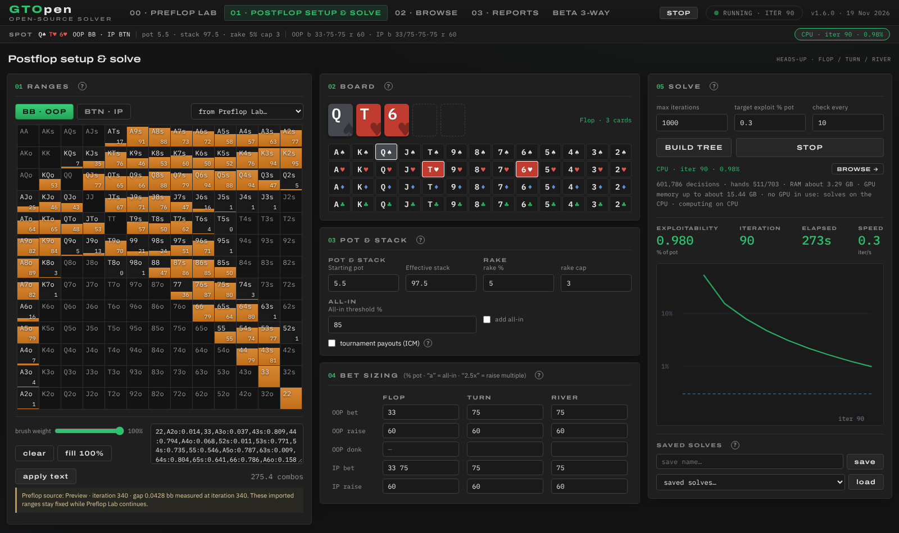
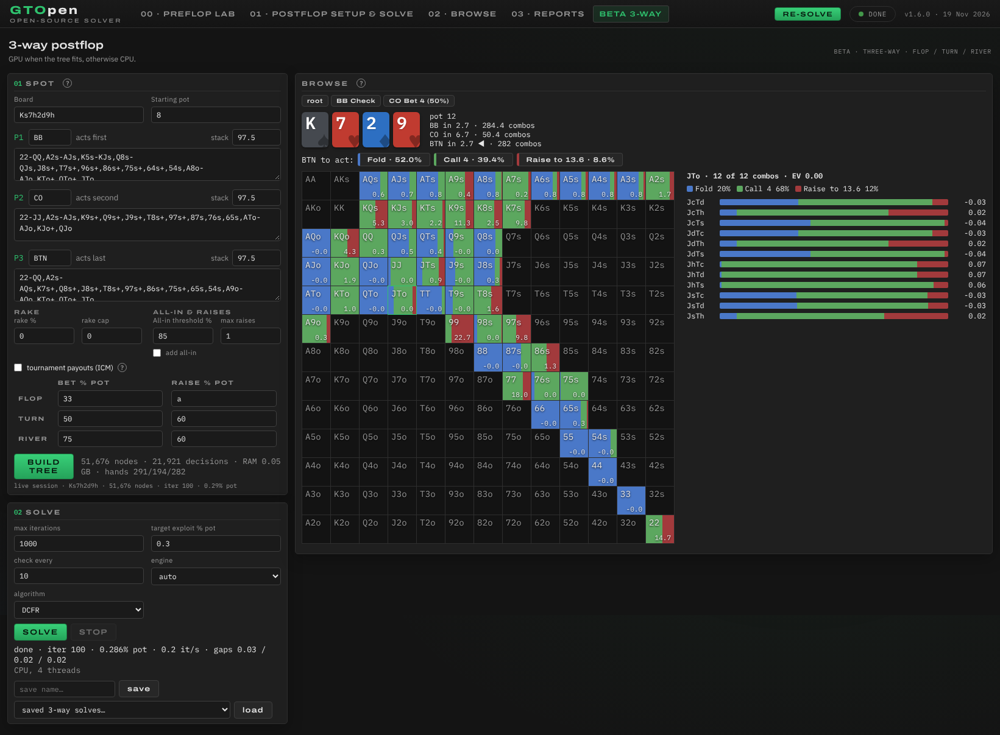

# GTOpen

An open-source poker solver for no-limit hold'em that runs on your own computer. Solve preflop for your exact game, solve any heads-up flop, lock in a player's mistakes to see the best reply, and compare a strategy across hundreds of flops.


## What you can do

- **Solve preflop for your game.** 2 to 9 players, cash or tournament, with your stacks, blinds, antes, straddle, rake and raise sizes.
- **Solve postflop spots.** Heads-up from the flop to the river with your own bet sizes. A flop reached in a preflop solve can be sent over with both ranges filled in.
- **Read every hand.** How often each hand takes each action, what each action is worth, and how the two ranges match up.
- **Lock a player and see the best reply.** Tell the solver how someone really plays a spot, then see how to play against it.
- **Play against real player types.** Player models built from online hand histories, or your own built from a few stats.
- **Compare across flops.** One setup solved on 47 to 1,755 flops, grouped by board type, with a search for the best bet size.

It runs in your browser from a local server. An NVIDIA GPU makes solving much faster, and everything also runs on the CPU.

## Get started

Install [Rust](https://www.rust-lang.org/tools/install) and Git, then get the code:

```sh
git clone https://github.com/MatthewPDingle/GTOpen.git
cd GTOpen
```

### Windows

Use the Rust MSVC toolchain and install the **Desktop development with C++** workload from Visual Studio Build Tools. Then run:

```powershell
.\GTOpen.cmd
```

The launcher builds the app, starts it and opens your browser. The first build takes a few minutes. If GTOpen is already running, the launcher reopens it and keeps your sessions.

To solve on an NVIDIA GPU, install the CUDA runtime compiler once before launching (needs Python and an NVIDIA driver):

```powershell
python -m pip install --target .cuda-nvrtc nvidia-cuda-nvrtc-cu12
.\GTOpen.cmd
```

### Linux / WSL

Install a C/C++ build toolchain, then run:

```sh
./start.sh
```

Open **http://127.0.0.1:3737** in your browser. The launcher builds for the GPU when it finds NVIDIA support and for the CPU otherwise. To use the GPU without a full CUDA toolkit:

```sh
python3 -m pip install --target ~/.local/cuda-nvrtc nvidia-cuda-nvrtc-cu12
./start.sh
```

For a manual CPU build, run `cargo build --release -p server`, then `./target/release/gto-server` from the repository root.

Big games need a lot of memory. The app says how much RAM and GPU memory a game needs before you solve it, and solves on the CPU when the game does not fit the GPU.

## A tour of the app

The tabs run left to right in the order you would use them. You can start at Postflop Setup & Solve if you already have ranges; the Preflop Lab is optional.

### 00 · Preflop Lab

Set up a game for 2 to 9 players and solve it. Choose stacks (equal or per seat), blinds, an ante or big blind ante, a UTG straddle, rake, and raise sizes, or start from a built-in scenario. Then click through the action to see each seat's range at every decision.


- Hands are valued by how they play after the flop, using a neural net trained on real flop solves, and each hand accounts for the cards it blocks.
- Raise sizes can follow the action: more over limpers, the callers' money added to a squeeze, bigger 3-bets out of position.
- Tick **tournament payouts (ICM)** to solve for prize money, from a final table to a 1,000-player bubble.
- Give a seat a **player model** (a nit, a calling station, a measured online pool, or your own stats) and solve again to see how to play against it.
- When the action reaches a flop with two or three players, **Send to postflop setup** carries the ranges over.

### 01 · Postflop Setup & Solve

Enter or import both ranges, pick the board, and set the pot, stacks, rake and bet sizes. Press **Solve** on the same page and watch the solve close in on its target. Solves can be stopped, resumed and saved.



### 02 · Browse

Follow the action through the solved tree. The grid shows every hand's strategy, EV or equity, and the panel beside it shows the hands you pick, with how often each action is taken and what it is worth. Filter by hand group (top pair, flush draws, a suit) and step through turn and river cards.

**Node locking.** Pick hands in the grid, or leave it on the whole range, type how often they take each action, and press **Lock**. **Exploit** shows the best reply at once, and **Re-solve** lets both players adjust around the lock. The locks you have set are listed above the grid.


### 03 · Reports

Solve the setup across 47, 95, 184 or all 1,755 distinct flops and compare the results by board, high card, hand class or texture. Reports can also be run against a player model, put side by side, or swept over bet sizes to find the best size on each flop.


### Beta 3-Way

Build, solve and browse three-player postflop spots on one page. This part is still in beta.



*Screenshots are from version 1.6 (November 2026), solved on the CPU.*

## Good to know

- **Postflop solves play the whole hand out.** The answer is for the game you set up: it depends on the ranges, bet sizes, rake and locks you choose, and on how close to its target you let the solve run.
- **Preflop solves are approximate.** The Preflop Lab does not play out the flop, turn and river. It estimates what each hand is worth once the flop comes, so treat close decisions as close.
- **Rare preflop lines are not solved.** If the solution almost never takes an action, the ranges behind it mean nothing. The app marks these spots and shows how to study them.
- **Player models mix measurement and estimate.** The Evidence link in the Preflop Lab says which is which.

Sizes, rake, straddles, reports and the rest are covered in [Using GTOpen](docs/using_gtopen.md).

## Save and update

Use the Save controls before closing GTOpen. Everything is kept in the `saves/` folder inside the repository: postflop solves, preflop games, scenarios, player models and reports.

To update, stop any running solve, save, and run `git pull`. Then close GTOpen and start it again so it rebuilds. The header shows "restart GTOpen" while the running app is older than the files. Windows details are in [Updating on Windows](docs/windows_updates.md).

The version and its date show at the right end of the top bar. Click it for the [change log](CHANGELOG.md).

## Contribute compute

Have an NVIDIA GPU that sits idle? GTOpen pools flop solves to train the neural net behind the Preflop Lab's hand values. One command builds the solver, generates examples and uploads them to a public dataset, with credit to your GitHub login. [How to contribute](docs/contribute-compute.md).

[](docs/contribute-compute.md)

## More detail

| Topic | Guide |
| --- | --- |
| Using the app | [Using GTOpen](docs/using_gtopen.md) · [UTG straddles](docs/utg-straddles.md) · [Updating on Windows](docs/windows_updates.md) · [Change log](CHANGELOG.md) |
| Player models | [Player types](docs/player_types.md) · [Ignition](docs/ignition_models.md) · [CoinPoker](docs/coinpoker_models.md) · [Evidence labels](docs/model_evidence.md) |
| How it works | [Engine, settings, CLI and API](docs/technical_reference.md) · [Preflop values and rake](docs/preflop_balanced_model.md) · [Raise sizing](docs/preflop_action_sizing.md) |
| Running studies | [Overnight reports](docs/overnight_reports.md) · [Contribute compute](docs/contribute-compute.md) |
| Development and research | [Notes for developers](docs/development.md) |

The code is in `crates/solver` (the Rust engine), `crates/server` (the local server and API) and `web` (the browser page, no build step).
