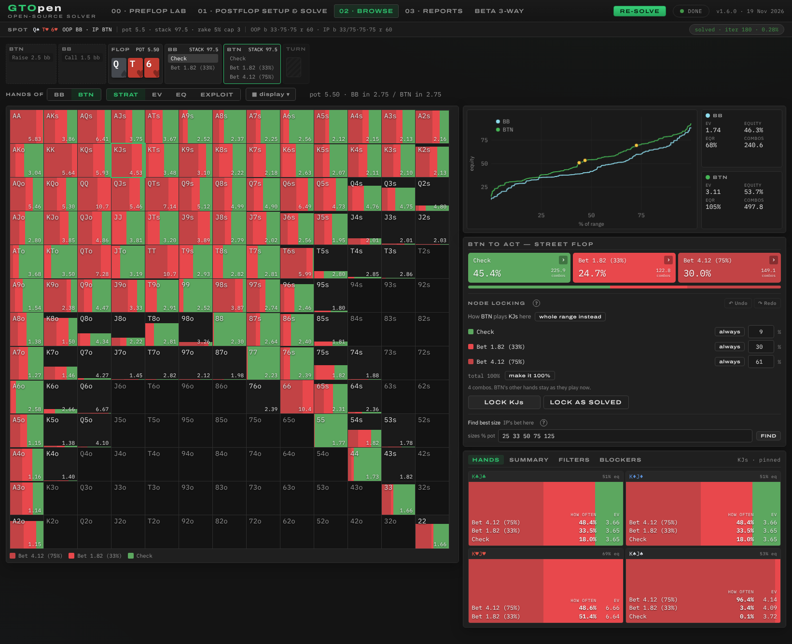
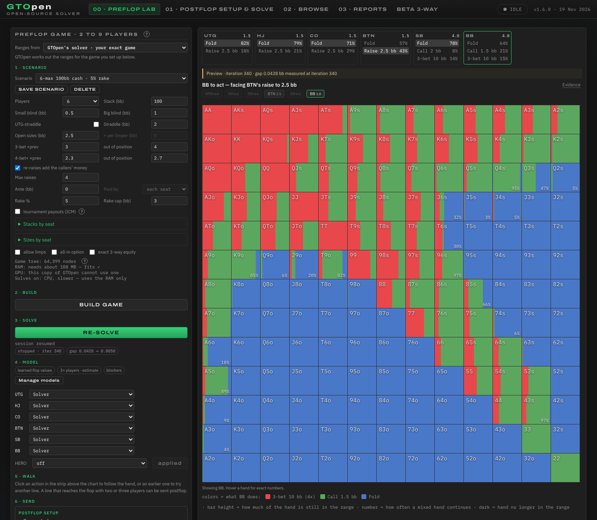
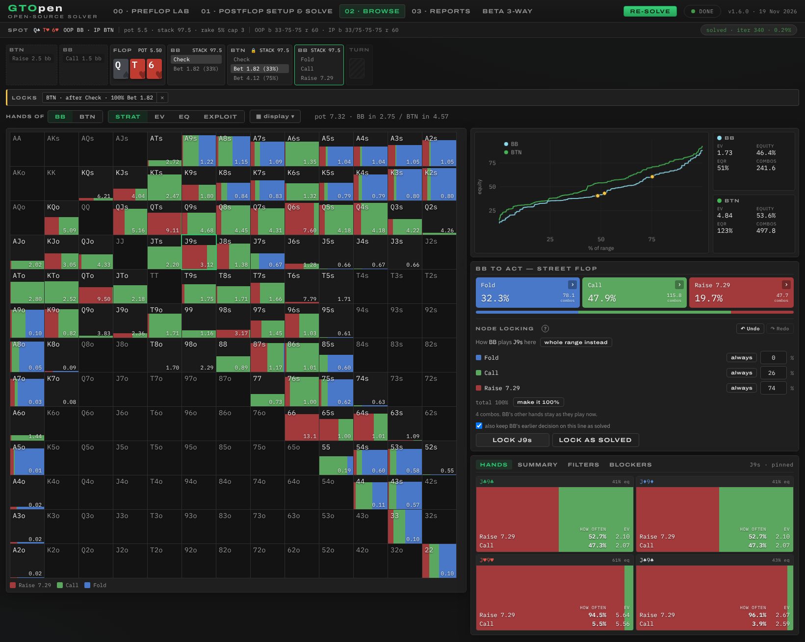
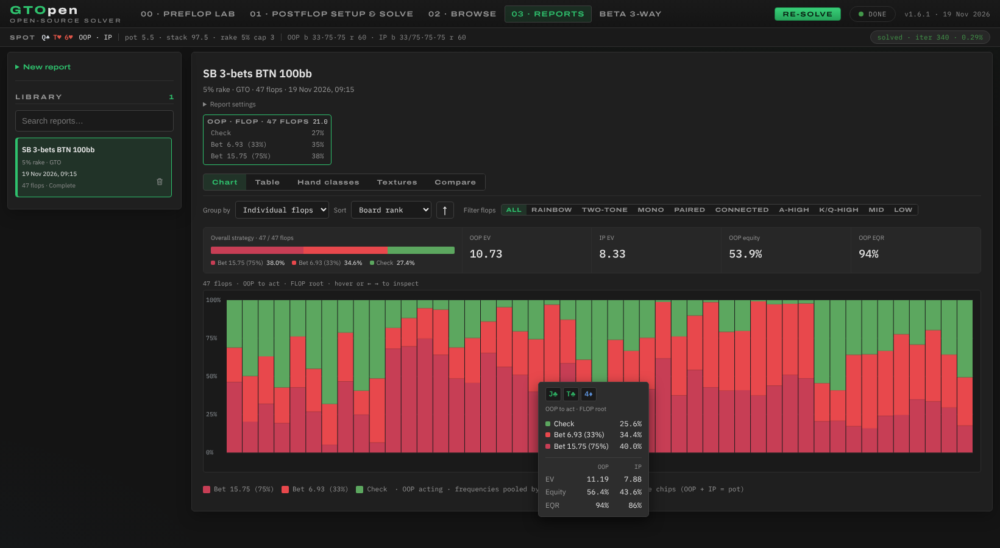
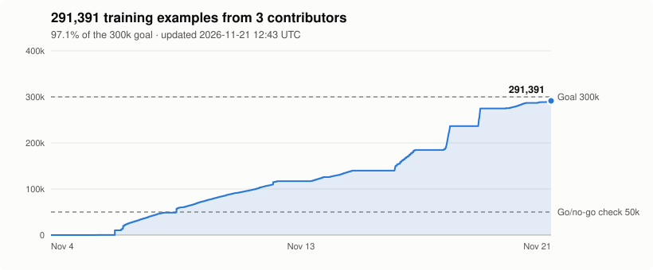

# GTOpen

An open-source GTO solver for no-limit hold'em that runs on your own machine. It solves heads-up postflop trees exactly, with node locking and aggregate flop reports, and solves preflop for 2 to 9 players with rake, antes, straddles and ICM. Player models built from online hand histories cover the exploitative side.



## What it does

- **Heads-up postflop, solved to the river.** Start from the flop, turn or river. Discounted CFR over every combo, with exact card removal and no hand or board abstraction. Your bet-size menu is the only abstraction. Exploitability comes from a true best response and is shown as % of pot.
- **Preflop for 2 to 9 players.** Cash or tournament, with per-seat stacks and side pots, rake and cap, antes or a big blind ante, a UTG straddle, and your own open, 3-bet and 4-bet sizes by seat. Flops are not played out: heads-up flop leaves are priced by a net trained on exact flop solves.
- **Node locking.** Lock combos, a hand class or a whole range at any node. Then read the max-exploit best response at once, or re-solve so both players adjust around the lock.
- **Player models.** Archetypes such as a nit or a calling station, measured Ignition and CoinPoker pools, or your own built from VPIP, PFR, 3-bet and fold-to-3-bet. Solve the max exploit against them, or dial it back toward equilibrium when you are less sure of the read.
- **Aggregate reports.** One spot across 47, 95, 184 or all 1,755 strategically distinct flops, with strategy, EV, equity and EQR by flop, texture and hand class, and an EV-maximising bet size search.
- **ICM.** Malmuth-Harville prize equity preflop and postflop, from a final table to a 1,000-player bubble.
- **3-way postflop (beta).** Three-player flop, turn and river spots with per-seat stacks.

It runs in your browser from a local server, on an NVIDIA GPU (CUDA) or on the CPU. On an RTX 3090 a 1.35M-node flop tree reaches 0.3% of pot in about 7 to 11 seconds ([benchmarks](docs/technical_reference.md#performance)).

## Get started

Install [Rust](https://www.rust-lang.org/tools/install) and Git, then get the code:

```sh
git clone https://github.com/MatthewPDingle/GTOpen.git
cd GTOpen
```

### Windows

Use the Rust MSVC toolchain and install the **Desktop development with C++** workload from Visual Studio Build Tools. Then run:

```powershell
.\GTOpen.cmd
```

The launcher builds the app, starts it and opens your browser. The first build takes a few minutes. If GTOpen is already running, the launcher reopens it and keeps your sessions.

To solve on an NVIDIA GPU, install the CUDA runtime compiler once before launching (needs Python and an NVIDIA driver):

```powershell
python -m pip install --target .cuda-nvrtc nvidia-cuda-nvrtc-cu12
.\GTOpen.cmd
```

### Linux / WSL

Install a C/C++ build toolchain, then run:

```sh
./start.sh
```

Open **http://127.0.0.1:3737** in your browser. The launcher builds for the GPU when it finds NVIDIA support and for the CPU otherwise. To use the GPU without a full CUDA toolkit:

```sh
python3 -m pip install --target ~/.local/cuda-nvrtc nvidia-cuda-nvrtc-cu12
./start.sh
```

For a manual CPU build, run `cargo build --release -p server`, then `./target/release/gto-server` from the repository root.

### macOS (Apple silicon)

GTOpen is reported to work on Apple silicon Macs, but it has not been thoroughly tested there. Follow the Linux steps: `./start.sh` builds for the CPU, since GPU solving needs an NVIDIA card.

### Memory

Big trees need a lot of memory. The app shows the RAM and GPU memory a tree needs before you build it. A preflop game too big for the GPU in one piece is solved on the GPU a part at a time with the same result, and anything that still does not fit solves on the CPU.

## A tour of the app

The tabs run left to right in study order. Start at Postflop Setup & Solve if you already have ranges; the Preflop Lab is optional.

### 00 · Preflop Lab

Build a 2 to 9 handed game and solve it, then click through the action to read each seat's range at every decision.



- **Tree.** Several open sizes, 3-bet and 4-bet multipliers by seat, separate out-of-position sizes, limps on or off, a raise cap and an optional all-in at every decision. Sizes can follow the action: more over limpers, the callers' money added to a squeeze.
- **Game.** Equal or per-seat stacks with side pots, rake and cap in bb, a per-seat or big blind ante, a UTG straddle, or a built-in scenario.
- **ICM.** Tick **tournament payouts (ICM)** and pick a stage, or enter your own payouts and the stacks at other tables.
- **Exploits.** Give a seat a player model and re-solve for the max exploit. With a hero seat chosen, the **trust** slider runs from full exploit to equilibrium (Restricted Nash Response).
- **Accuracy.** Each seat's best-response gap is shown in bb while the game solves.
- **To postflop.** At a flop with two or three players, **Send to postflop setup** carries the ranges, pot, stacks, rake and payouts over.

### 01 · Postflop Setup & Solve

Paint both ranges or paste them as text (`AA,KQs:0.5,A5s-A2s,AhKh`), or load them from a Preflop Lab spot. Pick a flop, turn or river board, then set the pot, effective stack, rake and cap.


- **Sizes** are per player and per street: bets as % of pot, raises as % of pot or a multiple, donk bets for the out-of-position player, an all-in threshold and an optional all-in everywhere.
- **Solve** runs to an exploitability target in % of pot (0.3 by default) and plots the convergence. Solves can be stopped, resumed and saved.

### 02 · Browse

Walk any line of the solved tree, including lines the solution does not take, and any turn or river card.

- **Views.** Strategy, EV or equity for the whole range, and each action's frequency and EV per combo. Compare equity with EV to see which hands over-realize or under-realize.
- **Range against range.** An equity distribution graph for nut advantage, and each card's blocker effect on the strategy.
- **Filters.** Narrow the grid to made-hand and draw classes or one suit.
- **Best size.** A search for the EV-maximising single bet size on the current board.

**Node locking.** Pick combos in the grid, use the hands your filters show, or leave it on the whole range. Type the frequencies and press **Lock**. For a range-level lock, choose how the frequency is spread over hands: scaled evenly, least EV loss, or least exploitable. **Exploit** shows the best response to the opponent as locked, with no solve. **Re-solve** finds the equilibrium of the locked game. A player model can also be locked onto every one of a seat's postflop decisions.



### 03 · Reports

Solve the setup across a 47, 95, 184 or 1,755 flop subset and read strategy, EV, equity and EQR at any node of the line, grouped by flop, high card, texture or hand class.



- **Compare** puts two reports side by side at the same node, for example two size menus or two rake structures.
- **Vs modeled villain** runs the report against a player model, with the same trust dial.
- **Best size sweep** finds the best single size on each flop, marks the sizes the solves cannot separate, and shows the EV given up by always using one size.

### Beta 3-Way

Build, solve and browse three-player postflop spots on one page, with per-seat stacks, side pots and ICM. This part is still in beta.


*Screenshots are from version 1.6 (November 2026), solved on the CPU.*

## Accuracy and limits

- **Heads-up postflop is exact for the tree you give it.** The solution is an equilibrium of your ranges, sizes and rake, as close as the exploitability target you set. Use 0.2 to 0.3% of pot for serious study. Locks change the game being solved, so exploitability then measures the locked game.
- **Preflop is a model, not a solve through the river.** It works on the 169 hand classes, with a blocker correction for the cards each hand removes from the other ranges. Heads-up flop leaves use learned values that depend on both ranges, the pot, the stack behind and the rake. Multiway leaves are priced as showdown equity with no postflop play, so multiway ranges are the least reliable. ICM games use a simpler estimate without the net.
- **Known preflop bias.** Flatting ranges against an open come out tighter than full-tree solutions. Treat close preflop decisions as close.
- **Low-frequency lines are not converged.** CFR weights a node by how often it is reached, so the ranges behind an action taken under 0.1% of the time mean nothing. The Preflop Lab marks these spots and shows how to study them.
- **Three or more players.** There is no guarantee of reaching a Nash equilibrium, and a multiway equilibrium is not unique. The best-response gap still measures how much each seat could gain by deviating.
- **Player models mix measurement and estimate.** The Evidence link in the Preflop Lab says which is which.

The engine, the preflop models and their validation are covered in the [technical reference](docs/technical_reference.md). Day-to-day detail is in [Using GTOpen](docs/using_gtopen.md).

## Save and update

Use the Save controls before closing GTOpen. Everything is kept in the `saves/` folder inside the repository: postflop solves, preflop games, scenarios, player models and reports.

To update, stop any running solve, save, and run `git pull`. Then close GTOpen and start it again so it rebuilds. The header shows "restart GTOpen" while the running app is older than the files. Windows details are in [Updating on Windows](docs/windows_updates.md).

The version and its date show at the right end of the top bar. Click it for the [change log](CHANGELOG.md).

## Contribute compute

Have an NVIDIA GPU that sits idle? GTOpen pools flop solves to train the neural net behind the Preflop Lab's hand values. One command builds the solver, generates examples and uploads them to a public dataset, with credit to your GitHub login. [How to contribute](docs/contribute-compute.md).

[](docs/contribute-compute.md)

## More detail

| Topic | Guide |
| --- | --- |
| Using the app | [Using GTOpen](docs/using_gtopen.md) · [UTG straddles](docs/utg-straddles.md) · [Updating on Windows](docs/windows_updates.md) · [Change log](CHANGELOG.md) |
| Player models | [Player types](docs/player_types.md) · [Ignition](docs/ignition_models.md) · [CoinPoker](docs/coinpoker_models.md) · [Evidence labels](docs/model_evidence.md) |
| How it works | [Engine, settings, CLI and API](docs/technical_reference.md) · [Preflop values and rake](docs/preflop_balanced_model.md) · [Raise sizing](docs/preflop_action_sizing.md) |
| Running studies | [Overnight reports](docs/overnight_reports.md) · [Contribute compute](docs/contribute-compute.md) |
| Development and research | [Notes for developers](docs/development.md) |

The code is in `crates/solver` (the Rust engine), `crates/server` (the local server and API) and `web` (the browser page, no build step).

## License

GTOpen is licensed under the [Apache License 2.0](LICENSE). The community training dataset is published separately under [CC BY 4.0](https://creativecommons.org/licenses/by/4.0/).
