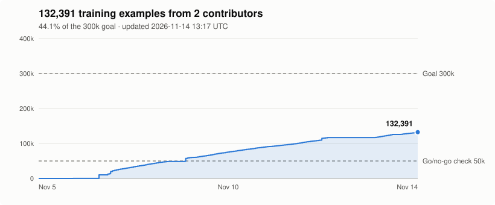

# Value-net training data progress

Generated automatically from the dataset's `progress.json` (by `tools/datagen/validate.py` after each merge, and by `.github/workflows/datagen-progress.yml`). See
[docs/contribute-compute.md](https://github.com/MatthewPDingle/GTOpen/blob/master/docs/contribute-compute.md).

[Contributors](contributors.md)
