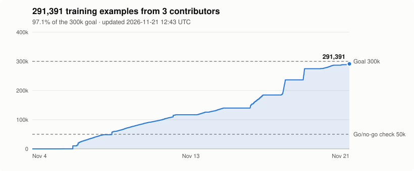

# Contribute compute: value-net training data

GTOpen is pooling GPU time to build the first public dataset of solved
heads-up flop values. The goal is a small neural network that gives the
Preflop Lab real postflop-solved values at every heads-up flop, instead of
today's realization model. Each example is one full flop solve, so the
dataset is far more than one desktop can produce quickly. Every GPU helps.




[Contributors](https://github.com/MatthewPDingle/GTOpen/blob/datagen-progress/contributors.md) ·
[Dataset on Hugging Face](https://huggingface.co/datasets/GTOpen/gtopen-leaf-values) ·
the count and the graph update as soon as uploads are validated.

**Status (2026-11-21): close to the 300,000 goal, and solving for the next net.**
The graph shows every validated example. Under it is what the pool has been
given to solve since when, and what that data is for.

| Since | What contributors solve | What it is for |
| --- | --- | --- |
| 6 Nov | Random ranges in a first set of games | The first check (below) and leaf nets v1 and v2 |
| 16 Nov | Random ranges in common live and online games ([game mix](#game-mixes) 1) | Leaf net v3, the learned flop values Preflop Lab uses today |
| 21 Nov | Game mix 2: half as mix 1, half spots from GTOpen's own preflop solves | Leaf net v4. **Target: 15,000 of these spots solved** |

Mix 2's spots are the ranges our own preflop solves reach a flop with, and
every hand a range does not hold is given a trace of weight so that the flop
solve prices it too. Today's net never saw a value for those hands and prices
them too low, which makes Preflop Lab call raises too rarely. A generator of
version 5 moved to mix 2 by itself; an older one needs one last `git pull`
and restart.

The first check, on 2026-11-09: at 57,400 examples a first net was trained and
scored on 56 held-out jobs it never saw. It beat every realization model
Preflop Lab had then, at both the hand-class and whole-range level, removing
about 10% of the pot (RMS) of the default model's error.

## What you need

- An NVIDIA GPU, ideally with 12 GB or more of VRAM. The generator sizes
  its spots to your card (trees up to 80% of its memory), so an 8 GB card
  works but gets the smaller spots. That is fine: big cards are handed the
  big spots (see [Cards of different sizes](#cards-of-different-sizes)), and
  training weighs every card's work so the pool counts as one. It also runs
  on a CPU, but each example takes minutes instead of seconds.
- [Rust](https://www.rust-lang.org/tools/install) and Git, set up as in the
  [README](../README.md#get-started). On Windows, also install the CUDA
  runtime compiler as described there (`python -m pip install --target .cuda-nvrtc nvidia-cuda-nvrtc-cu12`).
- Python 3 with `huggingface_hub`, and a free [Hugging Face](https://huggingface.co/join)
  account for uploads.

## Start contributing

1. Get or update GTOpen:

   ```sh
   git clone https://github.com/MatthewPDingle/GTOpen.git   # or: git pull
   cd GTOpen
   ```

2. Set up uploads once. Create a token with **write** access at
   [huggingface.co/settings/tokens](https://huggingface.co/settings/tokens), then:

   ```sh
   python -m pip install huggingface_hub
   hf auth login
   ```

3. Start generating, with the name you want credit under:

   ```powershell
   tools\datagen\contribute.cmd YOUR_NAME            # Windows
   ```

   ```sh
   tools/datagen/contribute.sh YOUR_NAME             # Linux / WSL
   ```

   The script builds the solver, generates until you stop it, and uploads
   finished jobs every 30 minutes. Add `--hours 8` to stop after eight
   hours, or `--jobs 5` to stop after five jobs. When it stops, it uploads
   whatever is finished.

That is all. When the project wants a different mix of games solved, your
generator moves to it by itself: see [Game mixes](#game-mixes).

**The name.** Your GitHub login is the natural choice, but you don't need a
GitHub account: nothing checks GitHub. The name picks your own block of job
numbers, so your spots never overlap anyone else's, and it is how you are
credited. It may contain letters, digits, `-` and `_` only. Keep using the
same name on every machine and every run, and don't pick a name another
contributor already uses: the same name gives the same job numbers, and a
job that is already in the dataset is rejected as a duplicate. The name is
public: it is written into every file you upload and listed on the
[contributors page](https://github.com/MatthewPDingle/GTOpen/blob/datagen-progress/contributors.md),
so use a handle rather than your real name if you prefer. The contributors
page links each name to `github.com/NAME`, so if you have no GitHub account,
pick a handle that no one uses on GitHub, or the link will point to a
stranger's profile.

### Just trying it: 100 solves

To test with a single job (100 examples) and stop:

```powershell
tools\datagen\contribute.cmd YOUR_NAME --jobs 1       # Windows
```

```sh
tools/datagen/contribute.sh YOUR_NAME --jobs 1         # Linux / WSL
```

It builds the solver (a few minutes the first time), solves one job, uploads
it, and exits. A job takes about 7 minutes on an RTX 5090; expect roughly 10
to 20 on an RTX 5070 Ti or 4080-class card (an estimate, not measured yet).
The upload needs the free Hugging Face account from step 2. Without one, the
finished job is saved as `datagen_out/YOUR_NAME/job-NUMBER.jsonl`, and you
can send that file to the maintainer instead.

Stopping is safe at any time (Ctrl+C or closing the window). The job in
progress restarts from its beginning next time; finished jobs are kept in
`datagen_out/` until they are uploaded.

A job is 100 examples. On an RTX 5090 a job takes about 7 minutes: most
examples solve in 1 to 8 seconds, wide limped spots in up to 20. Slower
cards take proportionally longer.

### Using Claude Code or Codex

An agent can do the setup for you. A prompt like this works:

> Read docs/contribute-compute.md in this repository and set up GTOpen
> training data generation on this machine for contributor name YOUR_NAME.
> Install what's missing, run one test job with
> `solve-cli datagen run --contributor YOUR_NAME --jobs 1`, then start
> `tools/datagen/contribute` in the background and stop watching it.

For a one-off test of 100 solves, end the prompt with this instead: "then
run `tools/datagen/contribute YOUR_NAME --jobs 1` (the .cmd on Windows) and
tell me when it has uploaded."

The generation itself is a long-running command and needs no agent, so
there is no reason to keep an agent session open (it only spends tokens).

### More than one GPU

Run one generator per GPU, each with its own slot:

```sh
CUDA_VISIBLE_DEVICES=0 ./target/release/solve-cli datagen run --contributor YOUR_NAME --worker 0 --workers 2
CUDA_VISIBLE_DEVICES=1 ./target/release/solve-cli datagen run --contributor YOUR_NAME --worker 1 --workers 2
python tools/datagen/upload.py --contributor YOUR_NAME --watch 30
```

### More than one solve on a GPU

Two `solve-cli` processes on the same card (a generator and a validator, or
two generators) take turns: each GPU solve waits until the one before it has
finished, and says so while it waits. Without turns two big trees can start
together, overflow the card and, on Windows, crawl in shared system memory
for as long as both are alive. Turns cost no speed, because solves that
share a card only time-slice it. Cards chosen with `CUDA_VISIBLE_DEVICES`
have a turn each. `GTOPEN_GPU_TURN=0` switches turns off. Both processes
must be a build that takes turns, so update and restart the generator and
the validator together.

### Running unattended (Windows)

To leave a machine solving for days, have Windows start the generator at
every sign-in and keep it running:

```
tools\datagen\autostart.cmd YOUR_GITHUB_LOGIN
```

This creates the scheduled task "GTOpen generator" for your user (not
elevated, no time limit). It runs `tools\datagen\keep-running.cmd`, which
starts the generator in a window, starts it again whenever it ends, and
restarts it when no solve has been written for three hours (a stuck solve).
Every 15 minutes the task looks that this is still running. Jobs carry on
from where they stopped; an example that was stopped twice is left out the
third time, so one bad solve cannot hold the machine. What it did is in
`datagen_out\keep-running.log`.

A restart only brings the generator back once someone is signed in, so set
Windows to sign in by itself if the machine may restart for updates. To stop
for good, run `tools\datagen\autostart.cmd remove` and close the window.
Creating the file `datagen_out\STOP` pauses it until the file is deleted.
Options after the login are passed to the generator, for example
`--max-vram 21 --reserve-gb 4` to leave room on the card for another program.

## Game mixes

What the pool needs changes over time: more live rake structures one month,
a set of specific situations from GTOpen's own preflop solves the next. What
your generator solves is therefore a **game mix**, a short published
description: which pot sizes, stacks and rake to draw and how often, and
which published lists of situations to draw from.

You do not have to do anything when the mix changes. Before every job (and
at most every five minutes) the generator reads the current list of mixes
from this repository,
[`tools/datagen/mixes.json`](../tools/datagen/mixes.json) on the `master`
branch, and starts its next job on the newest one. Its window says so:

```
NEW GAME MIX: moving from mix 1 to mix 2: ... Nothing to do on your side.
```

The job in progress is finished and uploaded as usual, so nothing is lost.
`solve-cli datagen mixes` shows the mixes and which one is current.

- **It is only ever a description.** A mix holds shares, ranges of numbers
  and the names of situation lists, all checked against fixed limits before
  use. It cannot name a program, a file on your machine or a web address,
  and your generator never downloads or runs new code by itself.
- **Situation lists** are files in the public dataset (`situations/`). A mix
  names a list together with its SHA-256, and your generator uses the file
  only if it matches.
- **Without a network** the generator carries on with the newest mix it has
  seen (it remembers the list in `datagen_out/.mix/`), and says once that it
  could not look.
- **When a mix needs new program code** (a new kind of solve, say), the
  window shows `PLEASE UPDATE` with what to do: stop it, `git pull`, start it
  again. Until you do, it keeps solving the newest mix it can, and those jobs
  still count.

The list is read with `curl`, which Windows 10 and later, macOS and nearly
every Linux system already have.

### Cards of different sizes

A card only solves trees that fit it: when a drawn spot is too big, the
generator draws again (the example's `attempt` counts how often). On its own
that would tilt the pool towards small trees, short stacks and 3-bet and
4-bet pots, because many contributors have smaller cards, while the big
spots (deep single-raised and limped pots) rest on the few big ones. Three
things keep the pool balanced:

- **Bigger cards get bigger games.** From generator v6 a mix can carry card
  rules: a card from a given size passes over most of the small trees, which
  any card can solve, and spends the time on the trees only it can hold. The
  window says so once (`this card keeps about 1 in 4 of the games under 6
  GB...`). Nothing changes for a small card.
- **Every example records its tree's size** (`tree_bytes`), and the progress
  graph counts the pool by size and a list's target by pot type, so a target
  cannot be met with small spots alone.
- **Training weighs the pool as the mix intends** (`tools/leafnet/balance.py`):
  a spot only big cards can hold counts for what the mix wanted of it, a spot
  every card can hold counts for less. What no contributor's card can hold
  stays missing, so big cards remain the most valuable.

### Three-player flops

From generator v7 a mix can be of **three-player flops** (`"players": 3`):
three random ranges, one stack, and an exact three-player solve of the flop.
The Preflop Lab prices a flop with three players in the hand as showdown
equity today, with no position and no betting; these solves say what such a
flop is really worth to each player. Game mix 4 is the first.

- **They are big.** A three-player tree is many times a heads-up one, so a
  job holds 10 examples, a solve takes minutes, and one solve ends after an
  hour whatever it has reached (`--max-minutes`). The bet menu `lean3-v1` is
  the heads-up menu with one raise per street on the flop and the turn and no
  raise on the river, which is what lets a 100 bb single-raised pot fit a
  32 GB card.
- **Small cards keep to heads-up flops.** A mix can ask for a card of a size
  (`min_card_gb`: the trees it must hold). A generator on a smaller card, or
  without a GPU, passes that mix over, says so once, and solves the mix
  before it, which still counts.
- **Jobs carry on after a stop.** A three-player job is written an example at
  a time, and a generator that is started again picks it up from the last
  finished example. An example the card could not hold beside whatever else
  was running is written as a `skipped` line and the job goes on.
- **Files.** A three-player job is `datagen_out/<login>/job3-<n>.jsonl` on
  your machine and `three/<login>/job-<n>.jsonl.gz` in the dataset, so it
  never mixes with the heads-up jobs under `data/`. The uploader handles
  both.

## What runs on your machine and what is uploaded

`solve-cli datagen` solves heads-up flop spots and nothing else. Each
uploaded job file holds the spot inputs (board, pot, stack, rake, both
ranges), the solved per-class values, equities and reach for both players,
the solve's accuracy and time, your contributor name, the GTOpen version and
whether it ran on GPU or CPU. Nothing else from your computer is read or
sent. The only things it fetches are the list of game mixes from this
repository and the situation lists a mix names from the dataset. Uploads go to a public dataset under the
[CC BY 4.0](https://creativecommons.org/licenses/by/4.0/) license, so by
uploading you agree to share your examples under it.

## How uploads are checked

Anyone can upload, so every upload is checked before it is merged:

- **Inputs are not chosen by contributors.** A job number and the game mix
  it belongs to determine all of its spots, and each login gets its own
  block of job numbers. The validator regenerates every example's inputs
  from the published mix and rejects any mismatch, and a job that names a
  mix that was never published is rejected.
  (The one exception is the [real-range game files](#real-range-game-files),
  which only the maintainers upload for now.)
- **A sample is re-solved.** The maintainer's machine re-solves three
  examples of every job and compares the values. A failed check rejects
  the upload, and a contributor caught sending bad data has all of their
  data removed.
- **Versions are pinned.** Each file records the generator version, the
  game mix and the bet menu. The validator accepts the current generator
  version and the two before it, so jobs finished before an update
  still count; their merge note then asks you to update when it suits you.
  Anything older is rejected with a note asking you to `git pull` and
  rebuild. Jobs of an earlier mix are accepted too, unless that mix was
  withdrawn.

Rejected uploads get a comment on their Hugging Face pull request saying why.

## The data

Each example is one line of JSON:

| Field | Meaning |
| --- | --- |
| `board`, `pot_type`, `pot_bb`, `stack_bb`, `rake_pct`, `rake_cap_bb` | The spot. Stacks are behind at the flop; `rake_pct` is a fraction (0.05 = 5%), capped at `rake_cap_bb`. |
| `pot_scale` | Present only when the pot was scaled up from its pot type's usual size: v4 1.3x to 2x for live tables and 2x to 4x for straddled ones, v3 1.6x to 2.6x. |
| `range` | Two lists of 169 class weights (OOP, IP) in the Preflop Lab class order. |
| `reach` | Combo mass per class after board card removal. |
| `eq` | Equity per class against the other range. |
| `value` | Solved value per class, as a fraction of the pot (pot-share convention: the two players' range averages add up to about 1 minus rake). |
| `iterations`, `exploit_pct_pot`, `seconds` | How the solve went. Solves stop at 0.5% of the pot. |
| `attempt` | How many draws were passed over before this one: trees over the job's memory cap (`max_vram_gb` in the file header), and from v6 small trees a card rule had a big card pass over. Training reweights by it. |
| `tree_bytes` | From generator v6: the estimated GPU memory of the example's tree, in bytes. Checked like the inputs. `solve-cli datagen tree-sizes FILE` gives it for older files too. |
| `situation` | Present only on an example drawn from a published situation list: `LIST/ID`. Its ranges, pot, stack and rake are that entry's (the output of a GTOpen preflop solve); the flop is random. |

The header line of a job file names the game mix it was drawn from (`mix`,
with `mix_key`, a fingerprint of what that mix draws).

The postflop menu is fixed and lean (`lean-v2`): one bet size per street
(33% on the flop, 75% on the turn and river), raises to 60% of the pot, and
at most a bet and a raise per street. Stacks are capped at 40 times the pot.

From generator v5 (2026-11-20) the mix of games is no longer part of the
program: it is a published [game mix](#game-mixes), and
[`tools/datagen/mixes.json`](../tools/datagen/mixes.json) lists every mix
there has been, with its shares. Mix 1 draws the same games as generator v4.
Generator v6 (2026-11-23) adds card rules to mixes and `tree_bytes` to
examples; it draws the jobs of mixes 1 and 2 exactly as v5 did, and uploads
of v3 to v6 are all accepted.

Generator v4 (from 2026-11-16) adds the games people commonly play live
and online. Pot types are 10% limped, 55% single-raised, 20% 3-bet and 15%
4-bet. Each pot comes from an online table (40%: pots as in v3, starting
stacks 25 to 200 bb), a live table (40%: pots 1.3x to 2x bigger for 3 to
6 bb opens and live re-raise sizes, stacks 50 to 300 bb) or a straddled
table (20%: pots 2x to 4x, stacks 50 to 400 bb); `pot_scale` records which.
Rake is none (20%), 5% capped at 0.5 to 12 bb (35%, online), 10% capped at
1 to 10 bb (35%, live rooms) or anything from 3% to 10% capped at 0.5 to
12 bb (10%).
Generator v3 (2026-11-09 to 11-16) drew 10% / 65% / 15% / 10%, scaled a
fifth of the pots up 1.6x to 2.6x, and drew rake none (30%), 5% capped at
2 to 4 bb (35%), 10% capped at 6 to 10 bb (20%) or 3% to 10% capped at 1 to
10 bb (15%). Generator v2 drew 15% / 45% / 28% / 12% with either no rake or
5% capped at 3 bb. Their examples stay in the dataset.
Ranges are sampled broadly
(top-x% and capped ranges, DeepStack-style random ranges, polarized and
mixed ranges) because the net has to be right on ranges the Preflop Lab
may produce later, not just today's.

To regenerate an example's inputs yourself:
`solve-cli datagen inputs JOB INDEX`, or `solve-cli datagen spot JOB INDEX`
for a config that `solve-cli` can solve directly. (A job number carries its
game mix, so nothing else is needed.)

### Weighing the pool for training

`python tools/leafnet/balance.py SNAPSHOT` writes `balance.npy` and
`balance.json` into a `prepare.py` snapshot: a weight per row that makes each
mix count as it was meant to, given the caps and card rules the pool's cards
drew under. Sizes of examples from before v6 are counted with `solve-cli
datagen tree-sizes` (no solve; about a fifth of a second per example on one
core, cached per file). `train.py` uses the weights with `CONFIG["balance"]`
(off by default). The report gives, per mix, each card size's share and how
often it took a draw, the share of big trees before and after weighing, and
the effective number of rows.

### Three-player job files

Files under `three/` hold three-player flop solves (format
`gtopen-flop-values-3p`, menu `lean3-v1`). An example has the same spot
fields as a heads-up one, with these differences: `range`, `reach`, `eq` and
`value` are three lists of 169, in postflop action order (the first acts
first on every street); `stack_bb` is the stack behind of all three; `value`
is each class's share of the starting pot, the three range averages adding
up to 1 minus the rake; `gaps_pct_pot` is each player's own best-response
gap and `exploit_pct_pot` their mean; `ended` says whether the solve reached
its target, its iteration limit or its time limit. A `skipped` line stands
for an example its machine could not solve. A game with three players has
more than one equilibrium and no guarantee of reaching one, so read the gaps
with the values.

### Real-range game files

The pooled jobs use random ranges on purpose. A second, smaller part of the
dataset, under `real/`, holds exact flop solves of the ranges GTOpen's own
preflop solves produce: a preflop game is solved in the Preflop Lab, the
heads-up flop situations that carry the most chips are exported with a few
random flops each, and each is solved with the same bet menu and accuracy
target as a pooled example. There is one file per solved preflop game,
`real/<contributor>/<set>/<game>.jsonl.gz`. Its examples have the fields
above, and its header describes the game (its preflop settings, the model
and net it was solved with, the exported lines, and whether GTOpen's own
training holds the game out as a check).

They exist because a net is least accurate exactly where its own solves go:
a preflop solve steers ranges toward the flop situations its value model
overrates. Exact solves of those ranges are what corrects that.

No ranges from charts, other solvers or any other outside source are ever
uploaded. Every range in the dataset is either drawn by the generator or the
output of a GTOpen solve.

These inputs cannot be regenerated from a job number, so the validator takes
game files only from the logins in `tools/datagen/config.json`
(`real_contributors`), checks every example's inputs and values for
plausibility and re-solves a sample. `real/README.md` in the dataset has the
field list.

A game mix can also hand such ranges to every contributor: the maintainers
publish a **situation list** (`situations/<list>.jsonl` in the dataset: one
entry per heads-up flop situation of a solved game, without a flop), a mix
gives it a share, and pooled jobs then draw entries from it on random flops.
Those examples sit under `data/` like any pooled job, carry `situation`, and
are checked like any pooled job, because the validator draws them again from
the same list. The rule above holds for lists too: only ranges that a GTOpen
solve produced.

## For the maintainer

```sh
cargo build --release -p solver --features gpu --bin solve-cli
python tools/datagen/validate.py --dry-run     # check open pull requests
python tools/datagen/validate.py --watch 60    # check, merge, update progress.json hourly
python tools/datagen/validate.py --local datagen_out   # check local files only
python tools/datagen/validate.py --recount     # only add merges that progress.json is missing
```

Each merge is written to `progress.json` straight away, and every pass starts
by adding any merged pull request that `progress.json` does not hold yet. So
the validator can be closed at any time: nothing it merged goes uncounted.
When Hugging Face answers "too many requests" it waits the pause it is asked
for and carries on, and a pass that fails in `--watch` mode is tried again
within five minutes.

A job file sent in by someone without a Hugging Face account: keep it as
`FOLDER/NAME/job-NUMBER.jsonl` (NAME is the contributor name in its first
line), check it, then upload it for them. It goes up under your Hugging Face
account and is still credited to NAME.

```sh
python tools/datagen/validate.py --local FOLDER
python tools/datagen/upload.py --contributor NAME --out FOLDER
```

At the first checkpoint, `tools/datagen/gonogo.py --wait 50000` waits for
50,000 validated examples, downloads the dataset, trains a small leaf-value
net on most jobs and scores it on held-out jobs against the realization
models Preflop Lab uses today. It writes the verdict to
`datagen_gonogo/report.md`, plus the net as `leaf_net.bin` (the format
solve-cli loads; `tools/datagen/export_net.py` converts an older `net.npz`).
`solve-cli datagen leafnet NET.bin < examples.jsonl` prints a net's values
per example.

To check a net on the ranges a real Preflop Lab solution reaches (rather
than the generator's), export a solved game's heads-up flop leaves, solve
them exactly and score them:

```
solve-cli datagen leaves GAME.bin --out datagen_leafcheck --leaves 40 --boards 8
solve-cli datagen solve datagen_leafcheck      # resumes if interrupted
python tools/datagen/leafcheck.py datagen_leafcheck
```

The report (`datagen_leafcheck/report.md`) compares the net with today's
models leaf by leaf.

To publish real-range game files from a folder of solved games (a
`manifest.json` plus one `datagen leaves` + `datagen solve` folder per game,
see `tools/leafnet/README.md`):

```sh
python tools/leafnet/realrange.py publish PILOT --contributor NAME --set round1 --out PUBLISH
python tools/datagen/validate.py --local PUBLISH/real      # the same checks the validator runs
python tools/datagen/upload.py --contributor NAME --real PUBLISH
python tools/datagen/validate.py --publish-notes           # once: real/README.md and the card's section
```

A published game file is never changed: solves that finish later go up as
another set. On a GPU that is shared with a generator, give the validator
`--real-max-vram 8` so it re-solves only trees that fit in 8 GB (a file with
no such tree is rejected rather than merged unchecked).

### Changing what contributors solve

Add a mix with the next id to `tools/datagen/mixes.json` and merge it to
`master`. Running generators pick it up before their next job, and the
validator reads the same file while it checks, so nobody restarts or updates
anything. The shares of a mix's parts add up to 1, and so do the shares
inside a `random` part (pot types, tables, rake). `cargo test -p solver --lib
datagen_mix` checks the file.

- **Say what it is for.** Add the mix to `"stages"` in
  `tools/datagen/config.json` (since when, what is solved, what the data is
  for, and a target if it draws from a situation list). The progress graph
  lists the stages under the total and marks where each began.
- **Never edit a published mix.** Uploads are checked by drawing their
  inputs again from the mix they name, so an edit would fail every job made
  under it. To change anything, add a new mix (to go back to an earlier one,
  add it again under the next id).
- To stop a mix whose jobs must not be accepted any more, set
  `"withdrawn": true` on it and add the mix that replaces it.
- A mix that needs new code in the generator says so with `needs_generator`
  (and that code raises `GENERATOR_VERSION`). Older generators then keep to
  the newest mix they can draw and ask their owners to update.
- **Card rules** (`"card_rules"`, needs generator 6): a list of
  `{"cap_from_gb": C, "under_gb": U, "keep": K}`, in ascending order of `C`. A
  card whose memory cap is `C` GB or more (80% of its memory, whole GB; the
  `max_vram_gb` of its jobs) keeps a drawn spot whose tree is under `U` GB
  only with probability `K` and otherwise draws again; the highest rule a card
  reaches applies. Pick `U` near what small cards can hold, so big cards leave
  those spots to them. Training undoes the rule's tilt as it undoes the caps'
  (`balance.py` reads the rules from this file), so a rule changes who solves
  what, not what the pool is worth.
- **A target by pot type**: a stage's `target` can say how many solves of
  each pot type it needs (`"by_pot_type"`, adding up to `"solves"`). The graph
  then counts a pot type only up to its share and shows a row for each, so
  extra small spots cannot fill the bar while big ones are short. Use the
  list's own shares (entries by pot type, times the target).

To have contributors solve the situations of solved games (ranges from GTOpen
solves only, never from charts or other tools):

```sh
solve-cli datagen leaves GAME.bin --out leaves/g01 --leaves 40      # per game
solve-cli datagen situations LISTNAME leaves/g01 leaves/g02 --out lists
python tools/datagen/validate.py --publish-situations lists/LISTNAME.jsonl
```

The last two commands print the part to put in the new mix
(`{"kind": "situations", "list": ..., "sha256": ..., "share": ...}`). Publish
the list before the mix is merged. A published list is never changed either;
a new round gets a new name.

Add `--tokens 0.0001` to `datagen leaves` to give every hand a range does not
hold that share of the range's largest weight. The flop solves then price the
hands just outside each range as well, which a leaf net needs to learn what
they are worth; the hands the range does hold keep their values.

`validate.py` needs a Hugging Face token with write access to the dataset.
After a merge it redraws the progress graph and force-pushes it to the
`datagen-progress` branch with your git credentials (at most every ten
minutes during a long pass, and once at its end; `--no-graph` skips this). `.github/workflows/datagen-progress.yml` does the same on a schedule
as a fallback, but GitHub often skips scheduled runs for hours. The dataset name, the go/no-go point and the goal live in
`tools/datagen/config.json`.
