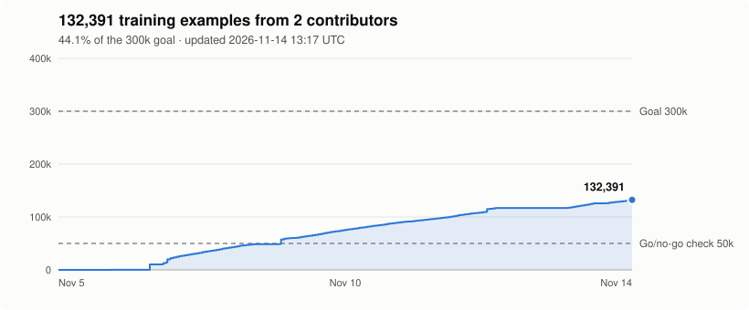

# Contribute compute: value-net training data

GTOpen is pooling GPU time to build the first public dataset of solved
heads-up flop values. The goal is a small neural network that gives the
Preflop Lab real postflop-solved values at every heads-up flop, instead of
today's realization model. Each example is one full flop solve, so the
dataset is far more than one desktop can produce quickly. Every GPU helps.




[Contributors](https://github.com/MatthewPDingle/GTOpen/blob/datagen-progress/contributors.md) ·
[Dataset on Hugging Face](https://huggingface.co/datasets/GTOpen/gtopen-leaf-values) ·
the count and the graph update as soon as uploads are validated.

**Status: first checkpoint passed (2026-11-09), collecting toward 300,000 examples.**
At 57,400 examples a first net was trained and scored on 56 held-out jobs it
never saw. It beat every realization model Preflop Lab uses today, at both the
hand-class and whole-range level, removing about 10% of the pot (RMS) of the
default model's error. The next goal is **300,000 examples**.

## What you need

- An NVIDIA GPU, ideally with 12 GB or more of VRAM. The generator sizes
  its spots to your card (trees up to 80% of its memory), so an 8 GB card
  works but gets the smaller spots. It also runs on a CPU, but each example
  takes minutes instead of seconds.
- [Rust](https://www.rust-lang.org/tools/install) and Git, set up as in the
  [README](../README.md#get-started). On Windows, also install the CUDA
  runtime compiler as described there (`python -m pip install --target .cuda-nvrtc nvidia-cuda-nvrtc-cu12`).
- Python 3 with `huggingface_hub`, and a free [Hugging Face](https://huggingface.co/join)
  account for uploads.

## Start contributing

1. Get or update GTOpen:

   ```sh
   git clone https://github.com/MatthewPDingle/GTOpen.git   # or: git pull
   cd GTOpen
   ```

2. Set up uploads once. Create a token with **write** access at
   [huggingface.co/settings/tokens](https://huggingface.co/settings/tokens), then:

   ```sh
   python -m pip install huggingface_hub
   hf auth login
   ```

3. Start generating, with your GitHub login so you get credit:

   ```powershell
   tools\datagen\contribute.cmd YOUR_GITHUB_LOGIN            # Windows
   ```

   ```sh
   tools/datagen/contribute.sh YOUR_GITHUB_LOGIN             # Linux / WSL
   ```

   The script builds the solver, generates until you stop it, and uploads
   finished jobs every 30 minutes. Add `--hours 8` to stop after eight
   hours, or `--jobs 5` to stop after five jobs.

Stopping is safe at any time (Ctrl+C or closing the window). The job in
progress restarts from its beginning next time; finished jobs are kept in
`datagen_out/` until they are uploaded.

A job is 100 examples. On an RTX 5090 a job takes about 7 minutes: most
examples solve in 1 to 8 seconds, wide limped spots in up to 20. Slower
cards take proportionally longer.

### Using Claude Code or Codex

An agent can do the setup for you. A prompt like this works:

> Read docs/contribute-compute.md in this repository and set up GTOpen
> training data generation on this machine for GitHub login YOUR_LOGIN.
> Install what's missing, run one test job with
> `solve-cli datagen run --contributor YOUR_LOGIN --jobs 1`, then start
> `tools/datagen/contribute` in the background and stop watching it.

The generation itself is a long-running command and needs no agent, so
there is no reason to keep an agent session open (it only spends tokens).

### More than one GPU

Run one generator per GPU, each with its own slot:

```sh
CUDA_VISIBLE_DEVICES=0 ./target/release/solve-cli datagen run --contributor YOUR_LOGIN --worker 0 --workers 2
CUDA_VISIBLE_DEVICES=1 ./target/release/solve-cli datagen run --contributor YOUR_LOGIN --worker 1 --workers 2
python tools/datagen/upload.py --contributor YOUR_LOGIN --watch 30
```

## What runs on your machine and what is uploaded

`solve-cli datagen` solves random heads-up flop spots and nothing else. Each
uploaded job file holds the spot inputs (board, pot, stack, rake, both
ranges), the solved per-class values, equities and reach for both players,
the solve's accuracy and time, your GitHub login, the GTOpen version and
whether it ran on GPU or CPU. Nothing else from your computer is read or
sent. Uploads go to a public dataset under the
[CC BY 4.0](https://creativecommons.org/licenses/by/4.0/) license, so by
uploading you agree to share your examples under it.

## How uploads are checked

Anyone can upload, so every upload is checked before it is merged:

- **Inputs are not chosen by contributors.** A job number determines all of
  its spots, and each login gets its own block of job numbers. The
  validator regenerates every example's inputs and rejects any mismatch.
- **A sample is re-solved.** The maintainer's machine re-solves three
  examples of every job and compares the values. A failed check rejects
  the upload, and a contributor caught sending bad data has all of their
  data removed.
- **Versions are pinned.** Each file records the generator version and bet
  menu. When they change, older uploads are rejected with a note asking
  you to `git pull` and rebuild.

Rejected uploads get a comment on their Hugging Face pull request saying why.

## The data

Each example is one line of JSON:

| Field | Meaning |
| --- | --- |
| `board`, `pot_type`, `pot_bb`, `stack_bb`, `rake_pct`, `rake_cap_bb` | The spot. Stacks are behind at the flop; 5% rake is capped at 3 bb. |
| `range` | Two lists of 169 class weights (OOP, IP) in the Preflop Lab class order. |
| `reach` | Combo mass per class after board card removal. |
| `eq` | Equity per class against the other range. |
| `value` | Solved value per class, as a fraction of the pot (pot-share convention: the two players' range averages add up to about 1 minus rake). |
| `iterations`, `exploit_pct_pot`, `seconds` | How the solve went. Solves stop at 0.5% of the pot. |
| `attempt` | How many draws were skipped because their tree was over the job's memory cap (`max_vram_gb` in the file header). Training can reweight by it. |

The postflop menu is fixed and lean (`lean-v2`): one bet size per street
(33% on the flop, 75% on the turn and river), raises to 60% of the pot, and
at most a bet and a raise per street. Stacks are capped at 40 times the pot. Ranges are sampled broadly
(top-x% and capped ranges, DeepStack-style random ranges, polarized and
mixed ranges) because the net has to be right on ranges the Preflop Lab
may produce later, not just today's.

To regenerate an example's inputs yourself:
`solve-cli datagen inputs JOB INDEX`, or `solve-cli datagen spot JOB INDEX`
for a config that `solve-cli` can solve directly.

## For the maintainer

```sh
cargo build --release -p solver --features gpu --bin solve-cli
python tools/datagen/validate.py --dry-run     # check open pull requests
python tools/datagen/validate.py --watch 60    # check, merge, update progress.json hourly
python tools/datagen/validate.py --local datagen_out   # check local files only
```

At the first checkpoint, `tools/datagen/gonogo.py --wait 50000` waits for
50,000 validated examples, downloads the dataset, trains a small leaf-value
net on most jobs and scores it on held-out jobs against the realization
models Preflop Lab uses today. It writes the verdict to
`datagen_gonogo/report.md`.

`validate.py` needs a Hugging Face token with write access to the dataset.
After each merge it redraws the progress graph and force-pushes it to the
`datagen-progress` branch with your git credentials (`--no-graph` skips
this). `.github/workflows/datagen-progress.yml` does the same on a schedule
as a fallback, but GitHub often skips scheduled runs for hours. The dataset name, the go/no-go point and the goal live in
`tools/datagen/config.json`.
