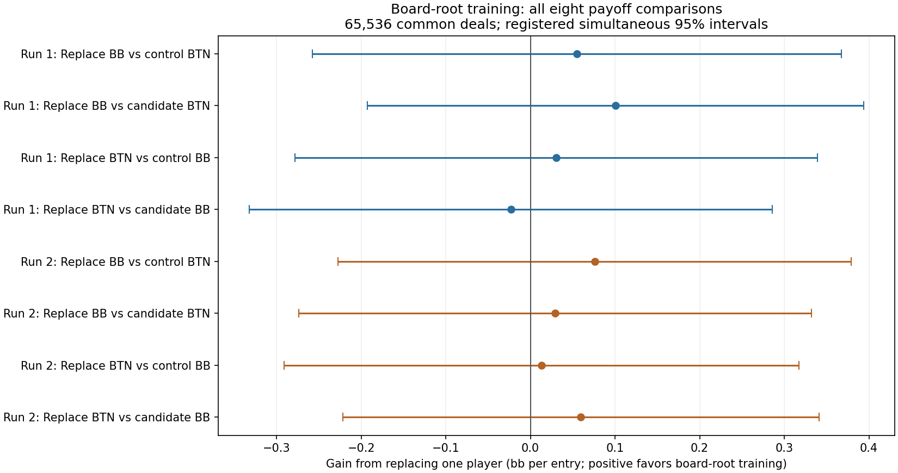

# Board-integrated root training: completed comparison

All eight registered payoff comparisons are included. The simultaneous intervals
support positive gains in **0**, negative gains in **0**, and leave
**8 inconclusive**. This concerns a replacement player against
a fixed opponent; it does not rank complete strategies or certify equilibrium.

## Scope and fixed design

Two board-root runs are compared with their two historical stratified controls
in the restricted 200bb BB-versus-BTN game: 2bb open, 0.5bb dead money, 5% rake
capped at 2bb. Each arm has 78 updates, 512 physical deals per update, and the
same optimizer budget. The paired arms share the physical source-deal seeds,
but evolving policies can produce different action paths.

Only the BB root regret estimator changes: four sampled public boards per
update are evaluated across compatible private hands, with original entry
weights and the qualified chance correction. Exact preflop terms remain separate.
The physical neural training targets are unchanged. This tests whether that
different root estimator improves learning, not whether it can look smoother.

Every played generation 0-77 is averaged with weights 1-78 and own-action reach.
Unplayed generation 78 is excluded. The comparison matches learning updates and
physical samples, **not total compute or elapsed time**.

## Range consistency

Entry-weighted cross-seed total variation is **49.65% for controls**
and **38.63% for board-root training**;
the difference is **-11.02 percentage points**.
A negative difference means greater agreement between these two runs. This is
descriptive consistency, not accuracy or EV loss. The most frequent action differs
in 96 control classes and
74 candidate classes, out of 169.

| Complete policy bank | Fold | Call | Raise | Jam |
| --- | ---: | ---: | ---: | ---: |
| 9266201-stratified | 43.14% | 40.62% | 15.94% | 0.30% |
| 9266201-board-root | 44.50% | 41.42% | 13.13% | 0.95% |
| 9266301-stratified | 37.28% | 40.42% | 21.67% | 0.64% |
| 9266301-board-root | 38.95% | 45.38% | 15.02% | 0.65% |

The [complete hand table](board-final-all-hand-classes.json) includes every class,
its entry mass, all four policies, and all four per-class comparisons.

## Payoff comparisons

The fixed evaluation uses 65,536 fresh common physical deals, seed **9281101**.
Positive gains favor the replacement player against the named fixed opponent.
Units are **bb per entry into this research spot**, not bb/100 dealt hands.
Intervals are the registered bounded empirical-Bernstein simultaneous 95%
intervals, with Bonferroni adjustment across eight contrasts at one final look.

| Replacement and fixed opponent | Mean gain | Paired standard error | Simultaneous 95% interval |
| --- | ---: | ---: | ---: |
| first:newBB-v-oldBB-against-oldBTN | +0.0549 | 0.0357 | [-0.2578, +0.3675] |
| first:newBB-v-oldBB-against-newBTN | +0.1005 | 0.0304 | [-0.1930, +0.3940] |
| first:newBTN-v-oldBTN-against-oldBB | +0.0302 | 0.0346 | [-0.2785, +0.3389] |
| first:newBTN-v-oldBTN-against-newBB | -0.0233 | 0.0348 | [-0.3326, +0.2860] |
| replication:newBB-v-oldBB-against-oldBTN | +0.0759 | 0.0331 | [-0.2273, +0.3792] |
| replication:newBB-v-oldBB-against-newBTN | +0.0290 | 0.0330 | [-0.2739, +0.3318] |
| replication:newBTN-v-oldBTN-against-oldBB | +0.0130 | 0.0334 | [-0.2913, +0.3173] |
| replication:newBTN-v-oldBTN-against-newBB | +0.0595 | 0.0270 | [-0.2219, +0.3409] |

An interval containing zero is inconclusive, not evidence of equivalence.
No favorable seed or checkpoint was selected. No additional deals, training
updates, or alternative interval were chosen after inspecting the outcomes.

## Computing cost

All times below are minutes, summed over each arm's 78 committed updates exactly
once. Retries, checkpoint validation between updates and other orchestration are
outside those update timers. Stages overlap and must not be added together.

| Arm | Update wall time | Physical pipeline wall time | GPU-fit stage wall time | Residual board wait |
| --- | ---: | ---: | ---: | ---: |
| 9266201-stratified | 60.37 | 26.87 | 22.85 | n/a |
| 9266201-board-root | 57.62 | 27.06 | 19.05 | 0.00 |
| 9266301-stratified | 58.24 | 26.35 | 21.99 | n/a |
| 9266301-board-root | 57.69 | 27.28 | 18.88 | 0.00 |

Board calculations overlap physical preparation and fitting. Zero residual wait
therefore does not mean zero board computation. The fit stage includes setup and
transfer work, not just GPU kernels. [Detailed cost evidence](board-final-costs.json)
also includes physical worker categories, optimizer timings and audit durations.
Historical controls ran earlier; these timings do not isolate a speedup.

The observed candidate storage peak at recorded quiescent boundaries was
**16.00 GB allocated**;
the enforced study allocation limit was 87.41 GB.
Final candidate allocation was 15.97 GB,
versus 15.88 GB recorded for the controls.
These are file-allocation measurements, not continuous peak telemetry. Candidate
storage includes retained prefix/recovery evidence, so the ratio is not a pure
algorithm-storage comparison. Decimal GB are used throughout.

## Verification and interpretation limits

Both 78-update candidate histories passed full independent readback. Complete
policy-bank GPU/CPU checks passed before the fresh evaluation. Its independent
review checked 2,048 batches and 29,771,344 policy
observations, with maximum statistical discrepancy 7.53e-13.
These checks share the native poker engine; they are not an independent poker
implementation or a best-response/exploitability certificate.

Scientific interpretation remains required before choosing the next experiment.
Other seats, stacks, bet sizes, multiway pots and agreement with GTO Wizard remain
unproven. No deployment or automatic promotion follows this report.
