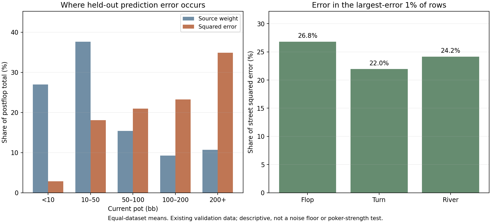

# Prediction-error readback

This CPU-only audit reconstructs all four saved 512-step baseline validation results and locates their errors. It uses existing data; no model was trained, no new deals were generated, and the final test stayed closed.

Maximum absolute difference from the saved GPU validation losses: **2.23e-08** (declared tolerance 1e-6). Disjoint bucket totals reproduce the full weighted error, target energy and source mass.

## Pot-size concentration

The percentages below are equal-dataset means. Pot refers to the current public pot, reconstructed from the native state catalog.

| Current pot | Rows | Source weight | Squared error | Target energy |
|---|---:|---:|---:|---:|
| under 10 bb | 26.73% | 26.98% | 2.88% | 2.08% |
| 10-50 bb | 37.79% | 37.66% | 18.06% | 13.67% |
| 50-100 bb | 15.47% | 15.40% | 20.95% | 19.75% |
| 100-200 bb | 9.27% | 9.24% | 23.25% | 20.89% |
| 200+ bb | 10.74% | 10.71% | 34.87% | 43.62% |

Large errors in large pots are not automatically a training defect: the objective is expressed in chip value, and costly mistakes deserve weight. These totals motivate controlled comparisons, not deleting examples or silently changing the loss.

## Repeated training inputs

Repeats have identical visible inputs and legal menus. The within-iteration column additionally requires the same training iteration. These counts combine rows from all four datasets; percentages are row-weighted, not equal-dataset means.

| Street | Training rows | Repeated rows across iterations | Repeated rows within iteration |
|---|---:|---:|---:|
| Preflop | 35,731 | 35,728 (99.992%) | 18,176 (50.869%) |
| Flop | 95,286 | 1,082 (1.136%) | 18 (0.019%) |
| Turn | 161,949 | 14 (0.009%) | 0 (0.000%) |
| River | 279,374 | 0 (0.000%) | 0 (0.000%) |
| Postflop | 536,609 | 1,096 (0.204%) | 18 (0.003%) |

The saved JSON includes every dataset/street, repeat-group effective counts, and observed target disagreement. An empirical mean fitted to two repeated examples understates predictive uncertainty. Singleton rows supply no repeat-based evidence. Policy drift, hidden-card variation, correlated samples and stochastic action rollouts may all contribute. This audit does not identify an irreducible noise floor.

## Largest-error rows

| Street | Squared error in largest-error 1% of rows |
|---|---:|
| Flop | 26.82% |
| Turn | 21.95% |
| River | 24.16% |
| Postflop | 23.83% |

Rows are ranked by their weighted squared error; the selected row count rounds upward. The metric describes concentration in this sample, not a confidence interval or a rule for excluding difficult examples.

## Runtime and scope

Elapsed time including storage admission: 134.0 seconds. Four CPU workers, one numerical thread each; maximum reported worker resident memory: 0.53 GB. CUDA was never initialized. Original weights and input files remained unchanged.

These are two existing runs and two player datasets per run in one restricted 200bb BB-versus-BTN game. The result does not validate ranges across other stacks, positions, sizes or multiway situations. Production remains unchanged.
