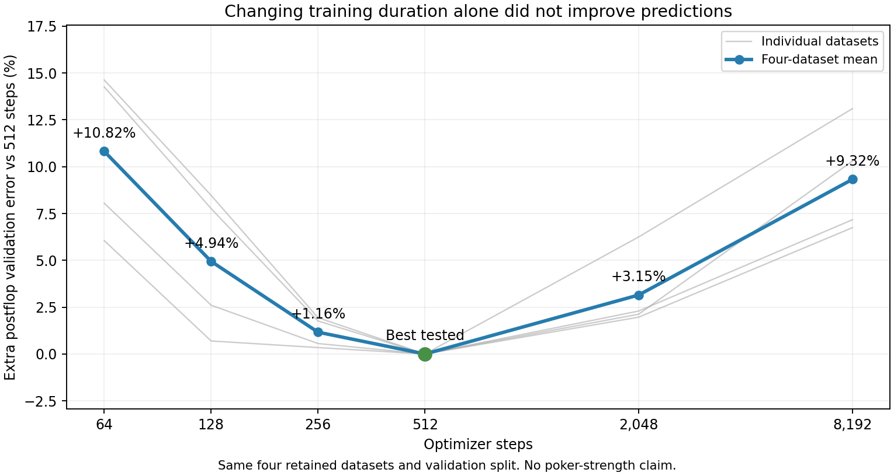

# Training duration is not the current fix

Across both completed diagnostics, **512 steps was best in each of the four datasets**. Shorter fits had not learned enough; longer fits increasingly overfit the retained examples. This narrows the next research direction but does not establish accurate preflop ranges.

| Steps | Mean postflop validation loss | Extra error versus 512 |
|---:|---:|---:|
| 64 | 1.381885 | +10.82% |
| 128 | 1.308629 | +4.94% |
| 256 | 1.261509 | +1.16% |
| 512 | 1.246987 | +0.00% |
| 2,048 | 1.286254 | +3.15% |
| 8,192 | 1.363250 | +9.32% |

The shorter-budget follow-up reproduced every saved 512-step parameter and validation loss exactly. It did not score the final test again. Both diagnostics used the same validation partition, so this is a tuning result rather than fresh confirmation.

The longer-fit street readback found the same pattern on flop, turn and river in every dataset. At 8,192 steps, mean postflop training error was 25.34% lower while validation error was 9.32% higher.

## Next experiment

Test explicit public betting-state inputs: pot size, remaining stacks, amount to call, call price and available action costs. These are currently represented indirectly through the public branch and action history. Keep existing card/history inputs and targets unchanged.

The new native exporter has passed known-value controls across five pot/stack fixtures. Its 450 public decision templates join correctly to all 815,799 rows in the four retained datasets. New input columns start with zero weights, preserving the original initial function. No network has yet been trained with these added inputs, and no range improvement is claimed.

A separately registered validation comparison should hold the 512-step budget, data, normalization, learning rate and initialization fixed. Keep the final test closed during exploratory tuning; require fresh full-policy evaluation before adoption. Production remains unchanged.
