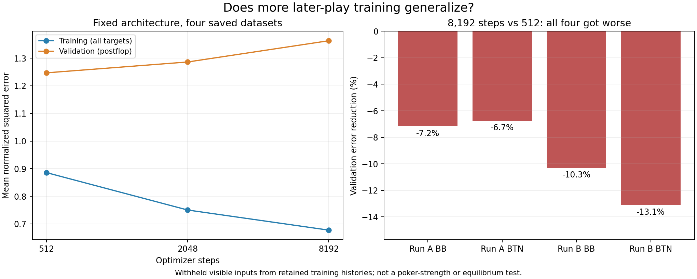

# Later-play fitting-budget experiment

Longer fitting did not win the registered validation comparison.

Validation selected the original **512-step** budget. Mean postflop validation error was **3.15% higher at 2,048 steps** and **9.32% higher at 8,192 steps**. The prescribed final-test comparison therefore contains only the baseline, with mean loss 1.230791; it is not an independent comparison of longer fits.

| Dataset | 512 train / validation loss | 2,048 train / validation loss | 8,192 train / validation loss |
|---|---:|---:|---:|
| 9266201-board-root-BB | 0.9361 / 1.2859 | 0.7960 / 1.3153 | 0.7192 / 1.3780 |
| 9266201-board-root-BTN | 0.8502 / 1.2082 | 0.7376 / 1.2320 | 0.6650 / 1.2897 |
| 9266301-board-root-BB | 0.8838 / 1.2608 | 0.7401 / 1.2876 | 0.6718 / 1.3907 |
| 9266301-board-root-BTN | 0.8728 / 1.2330 | 0.7274 / 1.3101 | 0.6534 / 1.3946 |

| Dataset | Training error reduction | Test postflop error reduction | Fitting-time ratio |
|---|---:|---:|---:|
| 9266201-board-root-BB | 0.00% | 0.00% | 1.00x |
| 9266201-board-root-BTN | 0.00% | 0.00% | 1.00x |
| 9266301-board-root-BB | 0.00% | 0.00% | 1.00x |
| 9266301-board-root-BTN | 0.00% | 0.00% | 1.00x |

Positive reductions mean lower error. Training includes all targets; the primary validation/test measure is postflop because separate tables override preflop neural predictions. Time ratios include resource pauses during fitting and exclude setup/checkpoint scoring.

| Dataset | Flop test reduction | Turn test reduction | River test reduction |
|---|---:|---:|---:|
| 9266201-board-root-BB | 0.00% | 0.00% | 0.00% |
| 9266201-board-root-BTN | 0.00% | 0.00% | 0.00% |
| 9266301-board-root-BB | 0.00% | 0.00% | 0.00% |
| 9266301-board-root-BTN | 0.00% | 0.00% | 0.00% |

## Scope and limitations

The 302/64/64/4 architecture, Adam learning rate 0.003, initialization and data were fixed. Each dataset used one continuous trajectory with checkpoints at 512, 2,048 and 8,192 steps. A salted 70/15/15 split kept identical visible inputs together. Scaling used only training targets. Validation selected a single common budget before final-test scoring of that budget and the baseline. Raw-row losses preserve source weights, legal-action masks and target variance.

These are held-out observations from the same adaptive training histories, not independent fresh-game trials. Related positions and earlier policies can occur across splits. The result does not isolate optimization from representation limits, prove an equilibrium, establish agreement with GTO Wizard, or establish transfer to different stacks or positions.

The run took 7.75 minutes and retained 1.19 MB of study files. Production was unchanged.

## Next decision

Do not increase production fitting time on this evidence. A bounded validation-only comparison of shorter fitting budgets is the cheapest next check, before considering regularization, representation and target variance. Keep the final test closed during that follow-up and require fresh full-policy evaluation before any adoption. Preserve this unsuccessful longer-fitting comparison.
