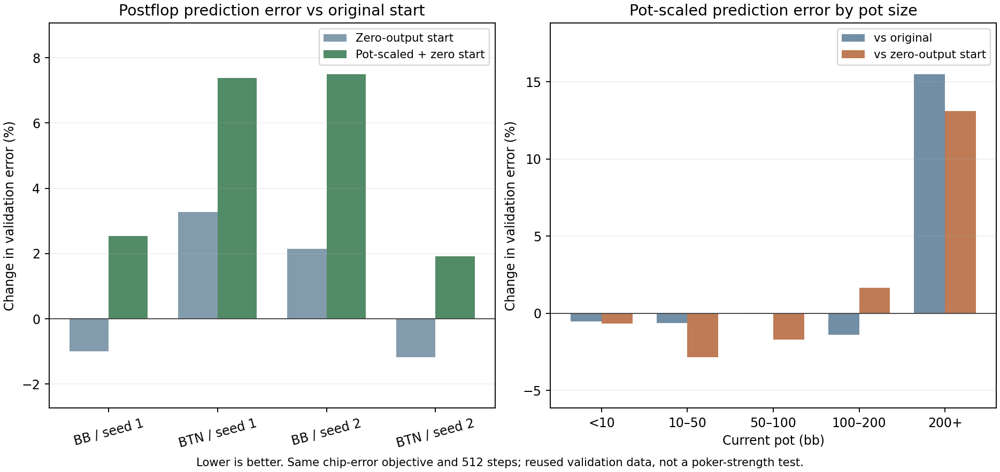

# Pot scaling does not pass the practical follow-up gate

Pot-scaled outputs changed mean postflop validation error by **+4.81% versus the original model** and **+3.99% versus the same zero-output initialization without scaling**. These are prediction results on reused validation data, not proof of more accurate or stronger poker ranges.

| Dataset | Original loss | Zero-output loss | Pot-scaled loss | Pot vs original | Pot vs zero-output |
|---|---:|---:|---:|---:|---:|
| 9266201-board-root-BB | 1.285863 | 1.272978 | 1.318449 | +2.53% | +3.57% |
| 9266201-board-root-BTN | 1.208221 | 1.247801 | 1.297308 | +7.37% | +3.97% |
| 9266301-board-root-BB | 1.260816 | 1.287867 | 1.355371 | +7.50% | +5.24% |
| 9266301-board-root-BTN | 1.233049 | 1.218586 | 1.256617 | +1.91% | +3.12% |
| Equal-dataset mean | 1.246987 | 1.256808 | 1.306936 | +4.81% | +3.99% |

## Predeclared decision

The gate required at least 1% lower mean loss than both baselines, lower loss in every dataset than both, and no under-50-bb loss increase in any dataset versus either baseline.

| Reference | At least 1% lower mean | Lower in all four | No under-50-bb regression |
|---|---|---|---|
| original | False | False | True |
| zero_output | False | False | True |

## Pot-size results

Each loss is an equal-dataset mean in the original normalized chip units. All input examples and source weights were retained.

| Current pot | Original loss | Zero-output loss | Pot-scaled loss | Pot vs original | Pot vs zero-output |
|---|---:|---:|---:|---:|---:|
| under 10 bb | 0.137776 | 0.137994 | 0.137046 | -0.53% | -0.69% |
| 10-50 bb | 0.578082 | 0.591132 | 0.574335 | -0.65% | -2.84% |
| 50-100 bb | 1.708770 | 1.738673 | 1.709235 | +0.03% | -1.69% |
| 100-200 bb | 3.250110 | 3.152604 | 3.204832 | -1.39% | +1.66% |
| 200+ bb | 4.179967 | 4.268307 | 4.828337 | +15.51% | +13.12% |

## Why the calculation remains comparable

The candidate predicts `g*f`, where g is the current public pot divided by 10 postflop and one preflop. Training targets divide by g while weights multiply by g squared, preserving the original chip-error loss and denominator. No difficult examples were removed, and errors were restored to original units before evaluation.

Both comparison arms start with zero outputs by zeroing only their last layer. Hidden-layer seeds and all other fitting settings match. The original initialization is retained as a third arm to separate initialization from scaling. All four original-arm repeats reproduced the saved weights and validation losses within 1e-7. Captured/eager training and factor-one controls matched exactly; direct gradient and scoring controls passed.

## Runtime and limits

Total time including preparation/storage admission: 4.26 minutes. Retained output size: 1.32 MB. Peak own CUDA allocation: 0.293 GB. Four CPU workers prepared inputs, and a single GPU trained the models with the desktop-sharing guard enabled.

The experiment reused four datasets from two existing runs of one restricted 200bb BB-versus-BTN game. No new deals or final-test scores were generated. It does not establish robustness across positions, stacks, sizes or multiway play. Production is unchanged.

## Next action

Preserve the full mixed/negative result. Do not promote pot scaling on this evidence. Inspect the separate initialization result and remaining data/policy uncertainty before another large training trial.
