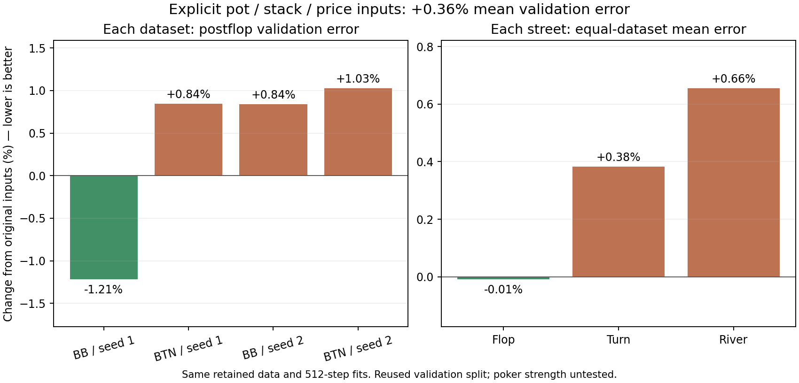

# Public betting inputs did not meet the improvement threshold

The 12 added public inputs changed mean postflop validation error by **+0.36%**. 1 of four datasets improved. This is a prediction diagnostic on retained training examples and a reused validation split; it is not evidence of stronger preflop play.

| Dataset | Original loss | Public-input loss | Change |
|---|---:|---:|---:|
| 9266201-board-root-BB | 1.285863 | 1.270257 | -1.21% |
| 9266201-board-root-BTN | 1.208221 | 1.218418 | +0.84% |
| 9266301-board-root-BB | 1.260816 | 1.271429 | +0.84% |
| 9266301-board-root-BTN | 1.233049 | 1.245703 | +1.03% |

The practical threshold was at least 1% lower mean loss and improvement in every dataset. It was not met.

## What changed

The original 302 inputs were retained. Twelve numerical inputs explicitly described the pot, remaining stacks, amount to call, calling price, effective stack-to-pot ratio, starting pot/stack and available action costs. The same facts were already implied by public betting history in this fixed game; the candidate made them easier to access. It also added 768 weights, so the comparison does not isolate representation from parameter count.

Data, split, seeds, target scale, network width, learning rate and 512-step fitting budget were fixed. The additional input weights started at zero. All four original-model repeats reproduced their saved weights and validation loss within 1e-7 (maximum parameter difference: 0). The CUDA training check matched ordinary training exactly on a multichunk real-data fixture spanning all streets.

| Street | Original mean loss | Public-input mean loss | Change |
|---|---:|---:|---:|
| Flop | 0.796236 | 0.796172 | -0.01% |
| Turn | 1.360224 | 1.365425 | +0.38% |
| River | 1.347028 | 1.355853 | +0.66% |

## Resources and limits

The full comparison took 4.37 minutes including preparation and resource checks. Retained outputs total 0.83 MB. Peak own CUDA allocation was 0.510 GB. Two CPU workers prepared datasets; one GPU trained the models. The light-desktop sharing guard remained enabled.

All inputs come from two existing training runs in the same restricted 200bb BB-versus-BTN game. The four seat/seed datasets are not four independent poker environments. No new deals or final-test scores were generated. No generalization across stacks, positions, sizes or multiway play has been established. Production is unchanged.

## Next step

Keep this negative or mixed result. Do not spend a full-policy training run on this representation yet. Use the existing training data to separate predictable structure from noisy sampled targets before choosing another larger experiment.
