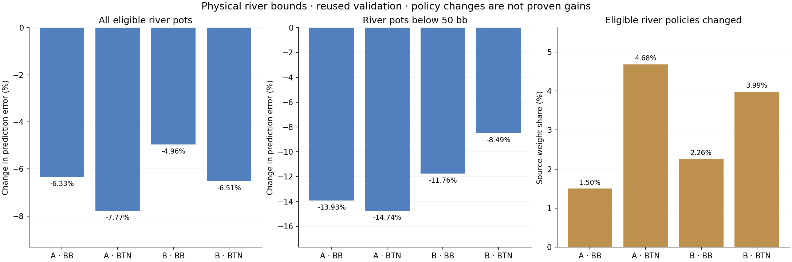

# River payoff bounds: prediction and policy diagnostic

Enforcing the exact Call-minus-Fold payoff limits changed mean eligible-river prediction error by **-6.350%**, under-50-bb error by **-12.185%**, and full-postflop action error by **-0.715%**. This establishes a prediction correction on reused data, not stronger poker play.

At verified terminal river Fold/Call decisions, the difference must lie between the incremental call lost and the current pot won net of rake. The correction moves only the two scores equally in opposite directions, preserving their sum. It uses public pot/call/rake information and the saved training scale; it needs no hidden cards or guessed opponent range. Other actions and all other streets remain unchanged.

## Fixed experiment and controls

Four original 512-step diagnostic fits were scored with their stored float32 weights and original float32 features widened to float64. These are the holdout-study fits, not the complete models used by the played policy bank. The original source weights, partitions and train-only scales were preserved. CPU/GPU score and policy comparisons, endpoint targets, negative-score fallbacks, exact ties, wrong-menu rejection, unit changes, common offsets and idempotence passed. Every scored row passed the registered non-increasing action-error check, and every eligible row passed the contrast-error check. Baseline losses reproduced the earlier float32 results within 1e-6.

| Validation metric (equal-dataset mean) | Original | Bounded | Change |
|---|---:|---:|---:|
| Full postflop normalized action error | 1.246987 | 1.238076 | -0.715% |
| River contrast error, bb² | 3866.709852 | 3621.190513 | -6.350% |
| River contrast below 50 bb, bb² | 252.386705 | 221.632988 | -12.185% |

## Coverage and policy changes

| Partition | Total rows | Eligible river rows | Violating rows | Changed policy rows | Mean violating weight | Mean changed-policy weight | Mean TV | Max violation, bb |
|---|---:|---:|---:|---:|---:|---:|---:|---:|
| train | 572,340 | 148,265 | 31,283 | 3,538 | 22.753% | 3.030% | 0.003113 | 245.682 |
| validation | 121,692 | 31,995 | 6,632 | 799 | 22.280% | 3.108% | 0.002993 | 234.667 |

Fractions and TV average the four datasets equally and use the eligible-river source weight within each dataset. These are sampled training/validation weights, not actual game reach frequencies. TV is half the action-probability L1 distance. A changed policy is neither automatically better nor worse.

## Per-dataset pot breakdown

| Dataset | Partition | Pot | Below / above | Violating weight | Max violation, bb | Mean violation, bb | Original contrast | Bounded contrast | Changed policy weight | TV |
|---|---|---|---:|---:|---:|---:|---:|---:|---:|---:|
| 9266201-board-root-BB | train | under 10 bb | 138 / 118 | 23.558% | 11.566 | 0.406 | 16.824 | 14.334 | 9.584% | 0.014879 |
| 9266201-board-root-BB | train | 10-50 bb | 1081 / 891 | 13.874% | 124.351 | 1.059 | 246.911 | 215.398 | 1.526% | 0.001419 |
| 9266201-board-root-BB | train | 50-100 bb | 2683 / 856 | 33.417% | 199.930 | 5.544 | 1121.511 | 887.519 | 2.331% | 0.001557 |
| 9266201-board-root-BB | train | 100-200 bb | 281 / 202 | 17.709% | 170.573 | 3.972 | 2840.330 | 2619.451 | 0.127% | 0.000158 |
| 9266201-board-root-BB | train | 200+ bb | 3043 / 934 | 24.319% | 227.776 | 5.391 | 6282.201 | 6035.687 | 0.830% | 0.000697 |
| 9266201-board-root-BB | validation | under 10 bb | 25 / 30 | 24.019% | 17.390 | 0.476 | 16.583 | 13.438 | 10.607% | 0.012958 |
| 9266201-board-root-BB | validation | 10-50 bb | 226 / 192 | 14.513% | 110.243 | 1.212 | 256.387 | 220.720 | 1.334% | 0.000912 |
| 9266201-board-root-BB | validation | 50-100 bb | 553 / 189 | 32.518% | 173.932 | 6.058 | 1357.817 | 1029.633 | 2.348% | 0.001781 |
| 9266201-board-root-BB | validation | 100-200 bb | 48 / 47 | 16.110% | 156.187 | 4.637 | 3516.921 | 3154.506 | 0.867% | 0.001175 |
| 9266201-board-root-BB | validation | 200+ bb | 704 / 202 | 24.426% | 188.933 | 6.355 | 10204.705 | 9749.512 | 0.697% | 0.000685 |
| 9266201-board-root-BTN | train | under 10 bb | 150 / 144 | 26.821% | 22.068 | 0.877 | 31.538 | 21.277 | 10.303% | 0.017307 |
| 9266201-board-root-BTN | train | 10-50 bb | 683 / 848 | 14.827% | 72.229 | 1.244 | 286.562 | 254.593 | 5.342% | 0.006647 |
| 9266201-board-root-BTN | train | 50-100 bb | 935 / 336 | 31.532% | 126.508 | 4.954 | 1213.624 | 1054.027 | 5.068% | 0.003943 |
| 9266201-board-root-BTN | train | 100-200 bb | 536 / 161 | 27.190% | 116.966 | 5.053 | 2162.007 | 1974.676 | 2.769% | 0.002046 |
| 9266201-board-root-BTN | train | 200+ bb | 1502 / 423 | 32.083% | 171.090 | 8.465 | 4795.223 | 4388.130 | 2.713% | 0.002351 |
| 9266201-board-root-BTN | validation | under 10 bb | 39 / 41 | 32.198% | 16.848 | 0.680 | 27.624 | 21.122 | 12.824% | 0.016669 |
| 9266201-board-root-BTN | validation | 10-50 bb | 164 / 185 | 14.860% | 83.337 | 1.399 | 296.469 | 253.064 | 5.450% | 0.006248 |
| 9266201-board-root-BTN | validation | 50-100 bb | 201 / 53 | 30.084% | 204.202 | 5.509 | 1511.610 | 1192.637 | 6.021% | 0.005507 |
| 9266201-board-root-BTN | validation | 100-200 bb | 117 / 19 | 25.377% | 86.678 | 4.763 | 2630.398 | 2439.212 | 2.886% | 0.002392 |
| 9266201-board-root-BTN | validation | 200+ bb | 307 / 78 | 28.933% | 204.737 | 9.330 | 11043.640 | 10340.790 | 1.772% | 0.001326 |
| 9266301-board-root-BB | train | under 10 bb | 33 / 213 | 25.276% | 20.296 | 0.981 | 24.453 | 14.711 | 15.431% | 0.050747 |
| 9266301-board-root-BB | train | 10-50 bb | 1017 / 898 | 12.961% | 87.108 | 0.781 | 231.070 | 214.061 | 1.968% | 0.002308 |
| 9266301-board-root-BB | train | 50-100 bb | 2290 / 809 | 32.150% | 197.717 | 5.005 | 1020.320 | 830.714 | 3.364% | 0.002770 |
| 9266301-board-root-BB | train | 100-200 bb | 352 / 174 | 18.468% | 245.682 | 3.087 | 2604.420 | 2480.264 | 0.769% | 0.000645 |
| 9266301-board-root-BB | train | 200+ bb | 2718 / 1083 | 24.380% | 177.310 | 5.114 | 5296.717 | 5077.182 | 1.355% | 0.001146 |
| 9266301-board-root-BB | validation | under 10 bb | 4 / 48 | 23.894% | 11.501 | 0.789 | 23.131 | 16.288 | 17.223% | 0.039852 |
| 9266301-board-root-BB | validation | 10-50 bb | 198 / 204 | 13.173% | 88.792 | 1.008 | 240.823 | 212.756 | 2.076% | 0.002664 |
| 9266301-board-root-BB | validation | 50-100 bb | 477 / 150 | 29.278% | 117.877 | 4.169 | 1260.605 | 1096.950 | 3.062% | 0.002481 |
| 9266301-board-root-BB | validation | 100-200 bb | 76 / 42 | 17.856% | 141.686 | 3.417 | 3301.773 | 3069.669 | 0.894% | 0.000903 |
| 9266301-board-root-BB | validation | 200+ bb | 553 / 227 | 23.239% | 196.332 | 5.426 | 9410.265 | 9041.070 | 1.309% | 0.000890 |
| 9266301-board-root-BTN | train | under 10 bb | 152 / 116 | 25.773% | 15.283 | 0.647 | 28.910 | 22.870 | 13.071% | 0.015782 |
| 9266301-board-root-BTN | train | 10-50 bb | 515 / 743 | 11.891% | 70.174 | 0.798 | 278.110 | 261.982 | 3.350% | 0.002762 |
| 9266301-board-root-BTN | train | 50-100 bb | 1299 / 283 | 30.749% | 127.283 | 3.686 | 1313.824 | 1209.221 | 5.356% | 0.003675 |
| 9266301-board-root-BTN | train | 100-200 bb | 552 / 220 | 31.335% | 109.853 | 5.353 | 2082.847 | 1883.019 | 2.996% | 0.002523 |
| 9266301-board-root-BTN | train | 200+ bb | 1566 / 305 | 29.141% | 128.556 | 6.140 | 4760.041 | 4473.941 | 1.677% | 0.000990 |
| 9266301-board-root-BTN | validation | under 10 bb | 33 / 25 | 23.748% | 12.963 | 0.469 | 25.385 | 20.497 | 9.199% | 0.013512 |
| 9266301-board-root-BTN | validation | 10-50 bb | 112 / 164 | 11.697% | 76.708 | 0.832 | 298.920 | 273.818 | 3.965% | 0.002971 |
| 9266301-board-root-BTN | validation | 50-100 bb | 283 / 75 | 31.662% | 116.510 | 4.565 | 1918.919 | 1683.671 | 4.935% | 0.003183 |
| 9266301-board-root-BTN | validation | 100-200 bb | 106 / 39 | 27.802% | 109.125 | 4.793 | 3303.549 | 3061.242 | 4.251% | 0.003333 |
| 9266301-board-root-BTN | validation | 200+ bb | 330 / 66 | 30.561% | 234.667 | 7.423 | 11714.483 | 11072.433 | 2.074% | 0.001099 |

## Limits and next decision

No new training, fresh deals, final-test scoring, policy-bank changes or production deployment occurred. The sources cover two synthetic runs of one restricted 200bb BB-versus-BTN game. The exact mathematical bound generalizes where its terminal-call assumptions hold, but these measurements do not qualify other stacks, positions, bet menus or multiway ranges.

Lower squared error is guaranteed only for valid targets under the equal-within-row action weighting tested here. The correction may still alter regret-matched policies, including probabilities of other actions through normalization. Before any runtime adoption, check complete historical banks, their per-model scales and their own-action reach weighting. Then require separate whole-policy and fresh-deal evaluation; do not infer EV gains from these loss numbers.

## Resources

The four CPU workers completed the full diagnostic in 2.23 minutes including the global storage admission scan. A short GPU equivalence control preceded it; the full data pass initialized no CUDA context. The global 800 GB allocation cap and production/shared-lock checks remained in force.
