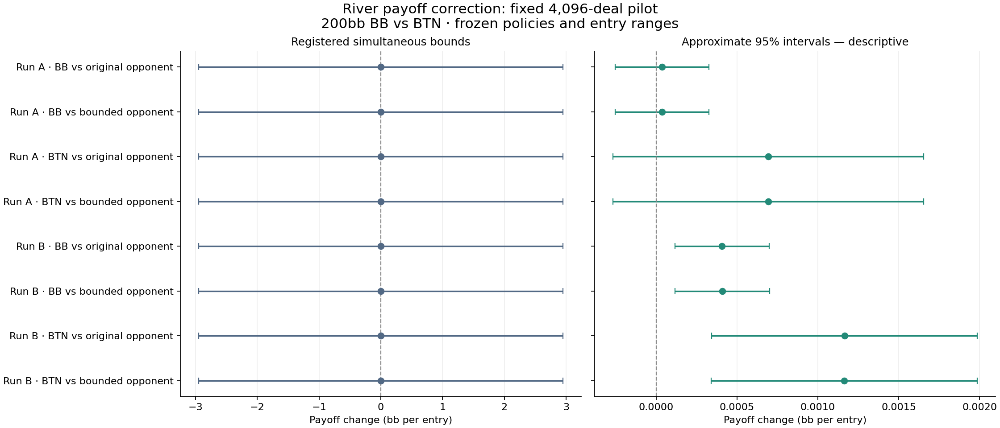

# River-bounds policy pilot

Completed **4,096 fresh physical deals**, evaluating eight BB/BTN policy combinations on each common deal. All eight registered bounded intervals include zero. This is a restricted policy-effect pilot, not evidence of a newly solved preflop equilibrium.

## Payoff changes

Positive values favor replacing the named player with the bounded version. Units are bb per entry to the fixed BB-versus-BTN subtree, not bb per dealt full-table hand. The bounded intervals have the registered 5% family error allowance across all eight comparisons. The approximate intervals use mean ±1.96 standard errors; they are descriptive and do not supply the same guarantee.

| Run / player / opponent | Mean gain | Standard error | Simultaneous bounded interval | Approximate 95% interval |
|---|---:|---:|---:|---:|
| Run A · BB vs original opponent | +0.000037 | 0.000148 | [-2.949575, +2.949649] | [-0.000253, +0.000327] |
| Run A · BB vs bounded opponent | +0.000037 | 0.000148 | [-2.949574, +2.949649] | [-0.000252, +0.000327] |
| Run A · BTN vs original opponent | +0.000694 | 0.000490 | [-2.950149, +2.951537] | [-0.000267, +0.001655] |
| Run A · BTN vs bounded opponent | +0.000694 | 0.000490 | [-2.950150, +2.951537] | [-0.000267, +0.001655] |
| Run B · BB vs original opponent | +0.000407 | 0.000148 | [-2.949207, +2.950021] | [+0.000116, +0.000698] |
| Run B · BB vs bounded opponent | +0.000409 | 0.000149 | [-2.949207, +2.950026] | [+0.000117, +0.000702] |
| Run B · BTN vs original opponent | +0.001165 | 0.000419 | [-2.949423, +2.951752] | [+0.000343, +0.001986] |
| Run B · BTN vs bounded opponent | +0.001163 | 0.000419 | [-2.949425, +2.951750] | [+0.000341, +0.001985] |

## What was checked

The correction-off control reproduced all original native payoffs exactly on the archived 32-hand control. Correction-on/off transported probabilities matched recomputation exactly. Control hands were excluded from the pilot. The pilot completed its registered seed and sample count without outcome-dependent stopping. A real process restart after the first 32 hands resumed the saved chance and statistics prefix.

Independent readback checked every archived batch: **1,860,751 decision queries**, all legal action probabilities, all eight player combinations, conditional all-in labels, native values, paired differences and final statistics. Maximum observed cashflow discrepancy was 5.68e-13 bb; conservation discrepancy was 5.77e-14 bb. This review recomputed statistics and transport identities; it did not implement a second poker engine or rerun neural inference.

## Runtime and storage

The resumed invocation took **14.98 minutes**, including startup checks and model loading. This excludes the first one-batch invocation and the earlier transport control. Independent readback took 0.80 minutes using eight CPU workers. Pilot files occupied 66.70 MB; packed hand archives totalled 66.04 MB. The pilot stayed within its 2 GB allowance and the global 800 GB allocated-storage cap.

Peak own GPU tensor allocation was 0.270 GB and peak allocator reservation was 0.336 GB. The revised admission rule capped this allocator at 4 GB and reserved 2 GB of external headroom. GPU policy parameters and query preparation were shared between original and corrected policies; archive compression used up to four CPU workers. Light desktop use was allowed; heavier GPU work caused yielding. Low average GPU utilization is expected when native query generation, serialization, compression or resource checks dominate.

The largest measured paired standard deviation implies approximately **89 fresh deals** for a three-standard-error planning half-width of 0.01 bb per entry. This plug-in estimate is approximate and does not guarantee the bounded intervals will be that narrow. At the measured archive rate this would retain approximately 1.44 MB of packed batches, excluding startup and metadata. Any confirmation requires a separate design and fresh chance; this pilot must not be extended until a preferred sign appears.

## Limits

Only the validated terminal river Fold/Call decisions were corrected. The preflop ranges, model weights, action tree, stack, rake and entry distribution stayed fixed. The earlier reduction in prediction error does not by itself guarantee a profitable policy change. The two training runs and both player roles are reported separately. No production settings or solver code were changed.
