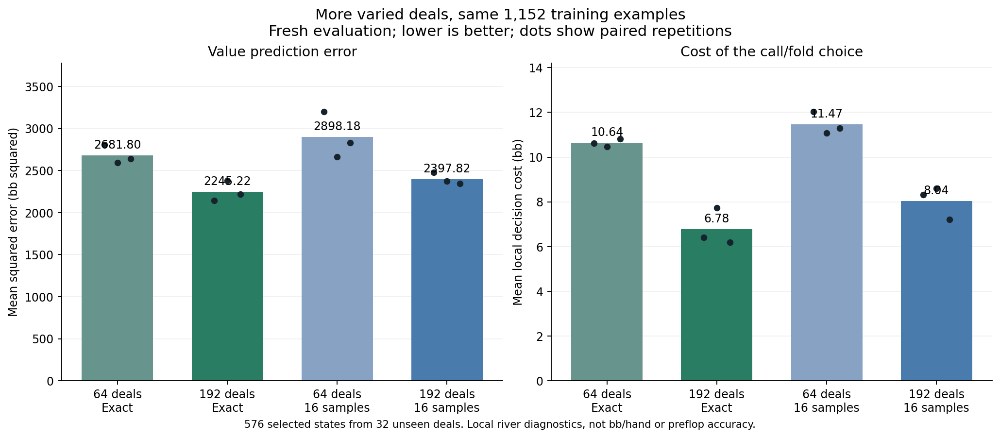

# Equal-budget deal coverage: fresh evaluation

Both descriptive gates passed; a separately controlled estimator-integration experiment is warranted.

Coverage gate: **True**. Exact-versus-16-sample target gate: **True**.
Failed checks: none.

## What changed

Both training sets contain 1,152 selected situations with matching actor/pot quotas. Dense uses 64 distinct physical deals and 18 states per deal. Broad uses 192 deals and six states per deal, with 384 shared rows. All four arms use the same visible features, 64/64 network, three paired initializations and 512 Adam steps. Dense and broad each compare exact conditional answers against 16 sampled opponents. The 48 models were frozen before scoring 576 states from 32 new final deals.

Old training labels retain their original identities and samples. The earlier 32 final deals were excluded. New board groups and complete visible keys are separated from training and spent evaluation. The old training set had already supported exploratory work, so fresh final deals are essential. This comparison balances selected query types rather than sampling actual gameplay reach.

## Results

| Training data / answer | Training exact MSE | Fresh MSE (bb squared) | Local decision cost (bb) | Direction agreement |
|---|---:|---:|---:|---:|
| 64 deals / exact | 1.729 | 2681.805 | 10.638 | 64.8% |
| 192 deals / exact | 8.599 | 2245.221 | 6.778 | 73.6% |
| 64 deals / 16 samples | 204.684 | 2898.184 | 11.472 | 63.0% |
| 192 deals / 16 samples | 205.643 | 2397.819 | 8.043 | 71.7% |

Bars average all banks, actors and repetitions equally. Dots show repetition means, not confidence intervals. States on a deal and comparisons against the same opponents are correlated; this small diagnostic makes no statistical significance claim.

## Bank and actor

Cells show MSE / local decision cost. All repetitions are retained.

| Bank / actor | Dense exact | Broad exact | Dense 16 samples | Broad 16 samples |
|---|---:|---:|---:|---:|
| A / BB | 2257.081 / 10.417 | 1735.600 / 4.892 | 2555.332 / 11.511 | 2018.407 / 7.311 |
| A / BTN | 3167.410 / 10.880 | 2323.042 / 6.759 | 3384.138 / 12.214 | 2599.957 / 9.045 |
| B / BB | 1953.242 / 9.813 | 1814.931 / 6.472 | 2372.704 / 11.310 | 1958.832 / 6.793 |
| B / BTN | 3349.485 / 11.443 | 3107.311 / 8.990 | 3280.561 / 10.853 | 3014.082 / 9.022 |

## Pot and rare-history breakdown

| Group | Dense exact MSE / cost | Broad exact MSE / cost | Dense 16 MSE / cost | Broad 16 MSE / cost |
|---|---:|---:|---:|---:|
| initialization_only | 3728.543 / 12.570 | 3031.591 / 7.270 | 4019.763 / 13.142 | 3312.636 / 9.353 |
| later_generations_contribute | 2475.102 / 9.839 | 1988.342 / 6.410 | 2609.335 / 10.558 | 2092.553 / 7.485 |
| hero_off_path | n/a | n/a | n/a | n/a |
| under10 | 38.903 / 1.051 | 38.369 / 0.723 | 54.792 / 1.032 | 71.825 / 0.635 |
| 10to50 | 226.205 / 3.598 | 197.821 / 2.102 | 283.144 / 3.784 | 290.355 / 2.350 |
| 50to100 | 734.613 / 7.366 | 592.138 / 4.194 | 888.611 / 7.867 | 768.568 / 5.250 |
| 100to200 | 2005.347 / 12.612 | 1488.878 / 8.142 | 2154.675 / 13.885 | 1756.369 / 9.579 |
| 200plus | 9082.504 / 23.771 | 7805.472 / 15.702 | 9688.001 / 25.571 | 7938.983 / 18.695 |

Group summaries average nonempty bank/actor/repetition groups equally. They do not replace the primary gate. Unsupported counts across the combined data by bank: [0, 0]. Equal effective actor/pot counts after support filtering: True.

## Interpretation boundary

Decision cost measures the wrong choice within the local Fold/Call pair; raising may also be legal. These values are per selected decision, not bb per dealt hand, exploitability, full-policy EV or measured preflop improvement. Two frozen original 78-generation opponents, inherited incoming ranges, one restricted 200bb BB-versus-BTN context and river-only targets limit transfer claims.

The coverage gate requires broad-exact to beat dense-exact in aggregate MSE and cost without worse cost in either bank. The target gate makes the analogous comparison against broad-sample16. Dense-sample16 is secondary, not a substitute winner. Failed checks remain failed; no added data, seed picking or tuning on this evaluation is allowed. Passing both still requires the estimator reach/importance-weight controls documented in BOARD-RIVER-TARGET-INTEGRATION-NOTES.md, followed by actual self-play training and fresh complete-policy evaluation.

## Verification and resources

The 1,344 new case labels passed independent scalar reconstruction across 4,309,730 exported observations; maximum discrepancy 3.64e-11. The original training labels were reused only through their verified hashes. CPU/GPU fitting controls and independent NumPy/Torch CPU prediction checks passed. Saved prediction metrics agreed within 1.82e-12.

Collection took 1680.9 seconds in its final invocation. Training took 65.8 seconds; final scoring took 6.6 seconds. New store allocation at scoring: 0.420 GB against 2 GB. Production, old archives and application windows were unchanged.

Evidence: `board-river-deal-coverage-v1-evaluation.json`, `board-river-deal-coverage-v1-report-readback.json`, the membership and frozen-model manifests, and their immutable source registrations. The broader preflop research goal remains active.
