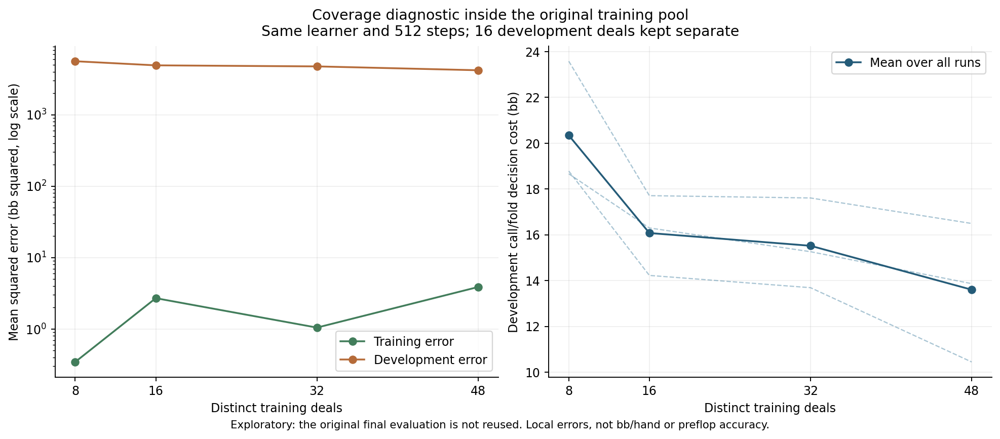

# Exact-target training coverage diagnostic

This exploratory diagnostic reuses only the original 64 training deals. It
keeps 16 of those deals separate for development validation and fits nested
sets of 8, 16, 32 and 48 deals. It does not re-score or tune on the original
32-deal final evaluation. Both banks, actors and all three new seeds are kept.

The architecture, visible inputs, exact targets, normalization, optimizer and
512-step budget remain fixed. All 48 models start fresh. Equal means over
banks, actors and repetitions are reported; no favorable run is selected.

| Training deals | Training MSE | Development MSE | Development decision cost (bb) | Direction agreement |
|---|---:|---:|---:|---:|
| 8 | 0.345 | 5613.440 | 20.339 | 58.9% |
| 16 | 2.699 | 4917.872 | 16.078 | 59.8% |
| 32 | 1.045 | 4753.082 | 15.520 | 59.1% |
| 48 | 3.869 | 4198.306 | 13.603 | 62.0% |

MSE is in bb squared. Decision costs concern the local Fold/Call pair, not
all legal actions or losses per dealt hand. Validation deals and all their
selected histories stay together. Multiple histories on one deal are not
independent samples. Dashed lines in the decision-cost plot are repetition
means, not confidence intervals.

| Bank / actor | Cost: 8 deals | 16 deals | 32 deals | 48 deals |
|---|---:|---:|---:|---:|
| A / BB | 13.633 | 12.994 | 8.527 | 8.946 |
| A / BTN | 26.783 | 21.072 | 22.354 | 16.485 |
| B / BB | 15.668 | 13.868 | 10.965 | 10.764 |
| B / BTN | 25.274 | 16.376 | 20.234 | 18.217 |

The original exact-versus-sampled probe still failed its registered integration
gate. This development curve does not reverse that result or qualify a model
for production. A downward trend can motivate broader coverage, but these
small subsets do not establish a scaling law. Any later candidate needs fixed
settings and new final evaluation deals.

Saved weights reproduced their stored predictions within 1.71e-13 bb;
scalar readback reproduced MSE and decision costs within 1.82e-12.
Checks covered all 48 fits, disjoint deal/board groups, exact split membership,
and original-final-deal exclusion. Computation took 63.92
seconds and retained 4.64 MB. No new
native label collection, full self-play training or production changes ran.

Evidence: `board-river-generalization-curve-v1-result.json`, `board-river-generalization-curve-v1-readback.json`, and the frozen plan and
registration. All predictions and model weights are retained in the study's
`generalization-curve-v1` directory.
