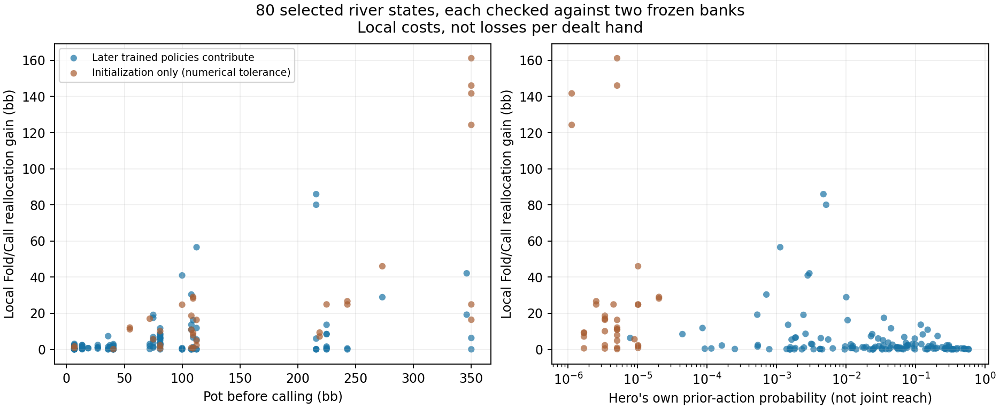

# Conditional river diagnostic: findings and next decision

The fixed 80-case diagnostic completed in **6.66 minutes**, and independent CPU readback passed.
It found room to improve Fold/Call decisions against each frozen model's own opponent range. This is more useful evidence for a training experiment than the tiny, inconclusive gains from the preceding river-bounds pilot. It does not establish improved preflop ranges.

## What was calculated

For every selected visible river decision, enumerate all 990 legal opponent hands, apply the original entry range, and weight each hand by the frozen opponent's probability of taking the actual prior actions. Compute exact Call minus Fold for that conditional range, including ties and configured rake. The actor never receives hidden cards or future board cards.

Both original 78-model banks were checked, giving **160 bank/case calculations** over **258,957 exported observations**. All selected histories have positive opponent support and positive hero history probability. Positive support alone does not mean that a history is common.

Each reported gain reallocates only the strategy's existing Fold/Call probability to the better of those two actions. Raise/jam probabilities stay fixed. It is a valid local improvement against the specified fixed opponent, not a full best response where raising is legal, and not a prediction of whole-game win rate.

## Results, with the rare-path qualification

| Current pot (bb) | Bank/cases | Mean local gain (bb) | Median local gain (bb) | Initialization-only cases |
|---|---:|---:|---:|---:|
| under10 | 32 | 0.844 | 0.569 | 2 |
| 10to50 | 32 | 1.204 | 0.804 | 1 |
| 50to100 | 32 | 6.101 | 5.238 | 7 |
| 100to200 | 32 | 10.925 | 6.042 | 12 |
| 200plus | 32 | 33.002 | 11.476 | 12 |

The cases were deliberately balanced across actor and pot size, selected from an old 32-deal archive before inference. This overrepresents some expensive and rare branches relative to actual play. The two bank measurements of one case are related, not independent hands. Do not report the overall mean of 10.415 bb as exploitability, bb/hand, or an expected deployment gain.

An explicitly **post-hoc** attribution check found that **34/160** decisions were supported only by the initial policy, to numerical tolerance. Their median hero prior-action probability was **5.07e-06**. The largest apparent errors were in this group: later trained strategies almost never take those same personal action paths. Their conditional behavior is consequently still the early uniform strategy.

This does not explain everything. In the other **126** bank/cases, where later trained strategies contribute, the median local improvement was **1.110 bb** and the mean was **5.541 bb**. Their median hero prior-action probability was **0.0328**. These remain selected-state diagnostics, not population estimates. All cases are retained; no averaging weights or support thresholds were changed.

## What this says about preflop modeling

The later-play policies still make avoidable decisions against their own modeled opponents. That matters because preflop calling and raising values depend on what happens after the flop. However, this diagnostic does not isolate a single cause: limited coverage, fitting error, training-target noise, policy drift, and finite training may all contribute. It does not prove that noisy targets alone caused the range discrepancies.

The conditional reference now gives us a practical way to test a more informative learning target. It is exact for this frozen opponent and restricted game, not an equilibrium oracle. The scope remains the inherited incoming ranges of the 200bb BB-versus-BTN subtree; other stacks, positions and multiway play are not validated.

## Next bounded experiment

Use a **new set of physical deals**, split by deal before selecting observations, for a small controlled target-learning comparison. Freeze the opponent. Compare training on the exact conditional Fold/Call contrast with training on sampled opponent outcomes whose expectation is that same contrast. Keep the visible inputs, selected training states, learner, normalization and fitting budget identical. Evaluate on untouched deal groups using exact contrasts, action direction and restricted decision cost. Record generation-zero support separately.

First verify that the sampled-label estimator is unbiased for the specified target and that no hidden information enters the input. This is a local supervised feasibility test, not a replacement for the current CFR advantage estimator. If it succeeds, derive and test the integration into the self-play estimator with its correct reach/importance weights. Then a separately registered full-policy comparison on fresh deals is required before claiming better preflop ranges or deploying anything.

Do not extend the small-bounds pilot solely to confirm its tiny gains, erase initialization from the frozen banks, or launch a broad retraining campaign on these 80 reused diagnostic cases.

## Verification and resources

Controls covered blockers, ties, rake, zero reach, suit relabeling, hidden-card isolation and equivalence with the existing native query exporter. Independent scalar readback reproduced entry weights, history likelihoods, equity and payoff arithmetic within **6.82e-13**; it reuses the native poker evaluator and is not a second independent poker engine. The behavioral-versus-mixture reach identity agreed within **2.27e-13**.

The run retained **137.43 MB**, including the earlier controls. Peak own CUDA tensors were **188.5 MB**, with **255.9 MB** reserved by the allocator. It shared light desktop use under the 4 GB allocation cap and 2 GB external headroom rule. Readback used eight CPU workers; attribution used four. Their elapsed times were 2.61 and 13.42 seconds.

Nothing was deployed. Original training banks, production settings and historical archives remain unchanged. The broader research goal remains active.

Evidence: `board-river-opponent-reach-v1-result.json`, `board-river-opponent-reach-v1-independent-review.json`, `board-river-opponent-reach-v1-attribution.json`, `board-river-opponent-reach-v1-analysis.json`, and their immutable registrations.
