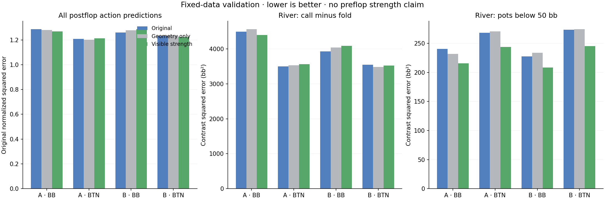

# Visible river strength does not pass the research advancement gate

Adding visible river strength changed mean river Call-minus-Fold validation error by **+0.75%** versus the original and **-0.25%** versus the geometry-only control. Mean under-50-bb river contrast error changed **-9.58%** versus original. Mean full-postflop action error changed **+0.10%**. These are reused-validation prediction results, not demonstrated poker accuracy.

## Fixed comparison

The four generation-77 datasets, input-disjoint partitions, source weights, train-only scales, seeds, 512 fitting steps and full-gradient Adam settings stayed fixed. The original arm retained 302 inputs; both other arms had 307, with zero-initialized added columns and otherwise identical original weights. All original fits reproduced their saved weights and validation errors within 1e-7. Initial functions matched exactly in the controls, and captured/eager training matched exactly for both added-input arms.

The five added inputs are zero except at river decisions with legal Fold and Call actions. They describe eligibility, net matched pot, incremental call, centered equity and the corresponding call value, with chip features divided by the public branch total. Geometry-only fixes equity at 50%; the strength arm enumerates all 990 legal uniform-opponent hands. No sampled hidden opponent, target outcome or future card is used as an input.

| Metric (equal-dataset mean) | Original | Geometry only | Visible strength |
|---|---:|---:|---:|
| Full postflop normalized action MSE | 1.246987 | 1.248853 | 1.248259 |
| River contrast MSE (bb²) | 3866.709849 | 3905.766373 | 3895.818550 |
| River contrast below 50 bb (bb²) | 252.386695 | 252.605290 | 228.218648 |

## Dataset results

| Dataset | Arm | Full postflop loss | River contrast | River contrast <50 bb |
|---|---|---:|---:|---:|
| 9266201-board-root-BB | original | 1.285863 | 4492.722 | 240.398 |
| 9266201-board-root-BB | geometry | 1.280325 | 4565.725 | 231.971 |
| 9266201-board-root-BB | strength | 1.269689 | 4401.558 | 215.315 |
| 9266201-board-root-BTN | original | 1.208221 | 3501.736 | 268.205 |
| 9266201-board-root-BTN | geometry | 1.202127 | 3535.158 | 270.438 |
| 9266201-board-root-BTN | strength | 1.211768 | 3565.671 | 243.684 |
| 9266301-board-root-BB | original | 1.260816 | 3926.608 | 227.654 |
| 9266301-board-root-BB | geometry | 1.278144 | 4037.650 | 233.704 |
| 9266301-board-root-BB | strength | 1.286859 | 4089.482 | 208.535 |
| 9266301-board-root-BTN | original | 1.233049 | 3545.773 | 273.290 |
| 9266301-board-root-BTN | geometry | 1.234816 | 3484.533 | 274.309 |
| 9266301-board-root-BTN | strength | 1.224722 | 3526.562 | 245.340 |

## Predeclared gate

| Requirement | Passed |
|---|---|
| lower_river_error_every_dataset | False |
| no_small_pot_regression_any_dataset | True |
| mean_postflop_does_not_increase | False |
| no_postflop_dataset_more_than_one_percent_worse | False |
| river_mean_at_least_one_percent_below_both | False |
| small_pot_mean_at_least_five_percent_below_both | True |

## Interpretation and next action

The strength input did not meet every predeclared requirement. Preserve the mixed or negative result without changing thresholds after seeing it. Do not promote the model or claim better preflop ranges; inspect the comparison with geometry-only and per-street errors before specifying another test.

The under-50-bb metric pools the two smaller-pot bands by source-weight mass inside each dataset, then averages datasets equally. Every contrast uses source-weight sum as its denominator, not legal-action count. Full postflop errors keep their original loss definition. Uniform equity remains an input the model can discount; it is not substituted for the actual opponent range.

All results concern two synthetic training runs of one restricted 200bb BB-versus-BTN game. The validation data informed this experiment’s hypothesis. No final-test predictions, new deal evaluations or production updates occurred. Other stacks, positions, size menus and multiway play remain unqualified.

## Resources

End-to-end runtime including storage admission: 4.22 minutes. Retained fit outputs: 1.31 MB. Peak own CUDA allocation: 0.500 GB. Four CPU preparation workers shared up to 16 native enumeration threads; one GPU performed the fits with the light-desktop sharing guard enabled. Visible-card caches were temporary memory only. The global 800 GB allocated-storage cap remained enforced.
