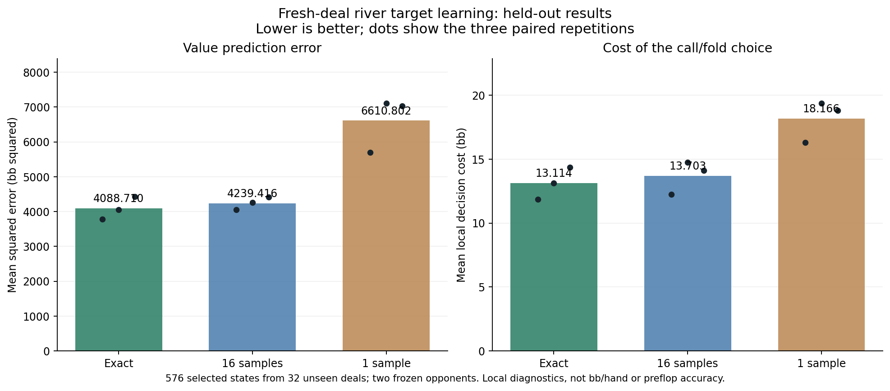

# Fresh-deal conditional river target learning

The exact-target arm did not pass the registered descriptive gate. This result does not justify integrating it into self-play or launching a larger training run yet. No production change is qualified by this supervised test.

## What this tested

The experimental later-play model still makes avoidable river decisions. This probe asks whether removing opponent-sampling noise from its training answers helps it learn the value of calling rather than folding. It uses the same visible inputs, network, initialization, 512-step fitting budget, and training examples for three targets: an exact conditional answer, the mean of 16 sampled opponents, or one sampled opponent.

The 96 new physical deals were split before observation selection: 64 deals / 1,152 training states and 32 deals / 576 final evaluation states. Board groups and complete observation keys are disjoint. Both original 78-model opponents are frozen. For each state, all 990 legal opponent hands are weighted by the original entry range and the probability of the actual action history. Hidden opponent cards and equity labels never become model inputs.

There are 36 fits: two opponents, two actors, three paired initializations and three target types. All fits were frozen before any final evaluation. These are contrast regressors, not CFR regrets or complete poker strategies.

## Aggregate results

| Training target | Training exact MSE (bb squared) | Held-out MSE (bb squared) | Held-out decision cost (bb) | Direction agreement |
|---|---:|---:|---:|---:|
| Exact conditional target | 3.312 | 4088.710 | 13.114 | 64.9% |
| 16 sampled opponents | 199.729 | 4239.416 | 13.703 | 63.0% |
| 1 sampled opponent | 3130.397 | 6610.802 | 18.166 | 57.6% |

Decision cost is the loss from choosing the wrong member of the Fold/Call pair. A zero prediction mixes the two equally. A zero true contrast incurs no decision cost. Raising may also be legal, so this is not a complete best-response test. Query-balanced costs are not bb per dealt hand, exploitability or expected deployment gains.

The bars average equally across banks, actors and repetitions, as registered. Dots are repetition means, not confidence intervals. Cases on one physical deal and comparisons against two banks are correlated. This is a small descriptive feasibility study, not a significance claim.

## Both banks and actors

Cells show held-out MSE / local decision cost.

| Frozen bank / actor | Exact | 16 samples | 1 sample |
|---|---:|---:|---:|
| A / BB | 3508.606 / 13.324 | 3548.388 / 11.387 | 5316.037 / 15.190 |
| A / BTN | 4463.230 / 13.229 | 4628.812 / 14.847 | 6882.447 / 18.654 |
| B / BB | 3542.341 / 11.793 | 3832.089 / 12.827 | 5867.085 / 18.186 |
| B / BTN | 4840.662 / 14.109 | 4948.374 / 15.753 | 8377.640 / 20.634 |

## Rare histories and pot size

Initialization-only means that later trained generations contribute no measurable own-history weight at this decision. Such rare histories remain in the study. The remaining rows have later trained contributions. Initializer classification uses the registered numerical tolerance, not a result-selected cutoff.

| Group | Bank/states, one repetition | Exact MSE / cost | 16 samples MSE / cost | 1 sample MSE / cost |
|---|---:|---:|---:|---:|
| initialization_only | 239 | 9501.436 / 25.099 | 10206.255 / 29.613 | 11951.162 / 29.469 |
| later_generations_contribute | 913 | 3264.435 / 10.914 | 3377.818 / 11.585 | 5758.247 / 16.137 |
| hero_off_path | 0 | n/a | n/a | n/a |
| under10 | 128 | 35.757 / 1.221 | 47.758 / 1.335 | 110.802 / 1.516 |
| 10to50 | 256 | 321.412 / 4.821 | 350.371 / 4.857 | 945.778 / 5.855 |
| 50to100 | 256 | 1310.781 / 10.618 | 1490.326 / 12.825 | 2620.675 / 13.250 |
| 100to200 | 256 | 2764.188 / 15.498 | 2977.576 / 14.780 | 5303.592 / 20.442 |
| 200plus | 256 | 13984.936 / 27.466 | 14235.218 / 28.535 | 20823.164 / 41.443 |

Group means retain equal bank/actor/repetition weighting among nonempty groups. They are diagnostic summaries, not a reweighted primary gate. Unsupported opponent-history counts by bank: [0, 0]; zero hero-history counts: [0, 0].

## Advancement decision and limits

The exact-target arm did not pass the registered descriptive gate. This result does not justify integrating it into self-play or launching a larger training run yet.

Failed registered checks: bank_0_exact_cost_not_worse_than_sample16.

The gate requires lower aggregate held-out MSE and decision cost than both sampled targets, plus non-increasing decision cost against each bank separately. All settings and repetitions are retained. No final evaluation result selects hyperparameters, additional iterations or a favorable initialization.

The scope is still a restricted 200bb BB-versus-BTN continuation with inherited incoming ranges. More accurate local river predictions do not prove equilibrium, better full-policy play or better preflop ranges. Successful integration would require the correct self-play reach and importance weights, independent estimator controls, retraining and a fresh complete-policy evaluation. Failure calls for inspecting fitting versus generalization limitations before further compute.

## Verification and resources

Independent scalar label reconstruction passed across 1,728 cases and 5,686,889 exported observations, with maximum arithmetic discrepancy 5.09e-11. Native poker outcomes are reused, so this is not a second poker engine. CPU/GPU training controls passed before fits. Every final prediction was independently reconstructed with NumPy and Torch CPU; the maximum difference was 1.28e-13 bb. Report readback reproduced the retained prediction metrics within 3.64e-12.

Retained study files total 0.518 GB against the 2 GB study limit. Training took 53.28 seconds; final scoring took 6.25 seconds using 8 CPU workers. Research shared light desktop use while yielding to production solves and heavier workloads. No production settings or historical archives were changed.

Evidence: `board-river-target-learning-v1-evaluation.json`, `board-river-target-learning-v1-report-readback.json`, the frozen model manifest, and their source/data registrations. The broader preflop research goal remains active.
