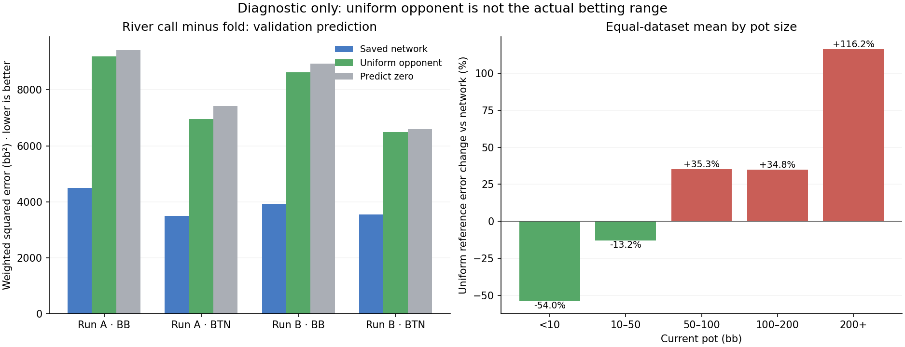

# River call-versus-fold diagnostic

The visible-card uniform-opponent reference changed mean validation squared error by **+102.16%** versus the saved network. It had lower error in **0/4 datasets**. This is a diagnostic on reused validation examples, not a demonstrated improvement in preflop ranges.

## Stored payoff accounting

All **180,260** eligible training/validation river records matched a legal win, tie or loss endpoint within the predeclared 1e-7 bb tolerance. The largest residual was 2.84e-14 bb. This rules out a simple payoff-unit or common-offset mismatch in these records. It does not independently verify the sampled opponent hand or establish that the sampling distribution is correct.

Native controls covered 228 facing-bet templates, 1,104 known-deal walk records, four rake configurations, both players and changed branch offsets. Eight card fixtures matched an independent Python hand-ranking implementation and the separate native board-rank exporter; serial/parallel, suit/card order, duplicate rejection and exactly 990 opponents were checked.

## Comparison

Values below are source-weighted squared error in bb² for one action contrast. The denominator is source-weight sum, with no multiplication by legal-action count.

| Dataset | Validation rows | Network error | Uniform opponent error | Zero error | Uniform vs network |
|---|---:|---:|---:|---:|---:|
| 9266201-board-root-BB | 10,563 | 4492.722 | 9195.482 | 9427.743 | +104.68% |
| 9266201-board-root-BTN | 5,329 | 3501.736 | 6956.212 | 7414.520 | +98.65% |
| 9266301-board-root-BB | 10,554 | 3926.608 | 8631.661 | 8933.008 | +119.82% |
| 9266301-board-root-BTN | 5,549 | 3545.773 | 6484.648 | 6591.288 | +82.88% |
| Equal-dataset mean | — | 3866.710 | 7817.001 | 8091.640 | +102.16% |

## What the reference knows

It uses only the acting player’s two cards, the five visible river cards, the current pot, the incremental call and configured rake. Every one of the 990 physically legal opponent pairs receives equal weight. Prediction = equity × (pot + call − rake) − call. The actual hidden opponent, stored outcome and future cards are not inputs.

A real opponent’s arriving range and decision to bet are not uniform. The reference deliberately omits those effects, so it is neither GTO nor the true expected value at the node. The saved model can use the visible betting history; the uniform hand-strength calculation cannot. Comparing their errors tests whether a simple physical relationship exposes structure missing from the learned predictions.

## Scope and next action

The reference does not consistently beat the existing model. Inspect the per-dataset and pot-size results before changing training inputs; do not replace range-conditioned predictions with a uniform-opponent policy.

These are synthetic solver-generated examples from two runs of one restricted 200bb BB-versus-BTN game, not newly measured site hand histories. No model was trained, no new deals were sampled and the final-test partition was not scored. Accurate play across positions, stacks, sizes and multiway situations remains unproven. Production is unchanged.

## Resources

End-to-end time including storage admission: 2.19 minutes. Four CPU preparation/inference workers and up to 16 native enumeration workers were used. 31,995 validation records reduced to 26,019 unique visible card sets and 25,758,810 opponent-pair evaluations. Native enumeration took 0.069 seconds. No GPU was initialized. Storage admission remained below the 800 GB allocation cap.
