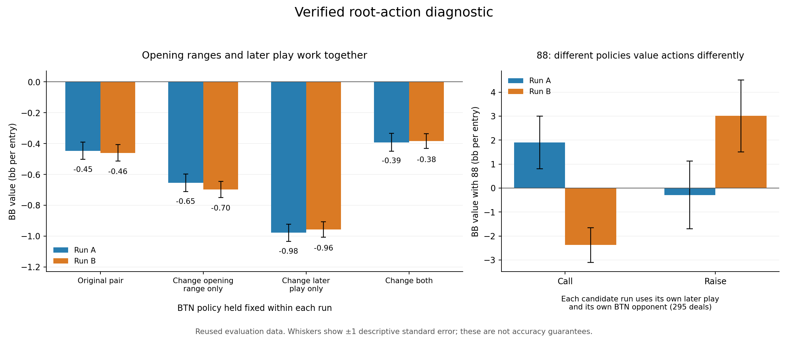

# What the completed action-value diagnostic tells us

The revised board-root approach made repeated runs more consistent, but it has
not yet demonstrated stronger or accurate preflop play. The two candidate runs
disagreed about their root action distributions by 38.63%, versus 49.65% for the
controls: about 22% less disagreement, not 22% more poker accuracy. All eight
original registered payoff comparisons remained inconclusive.

## The important finding

A preflop range cannot be assessed independently of the later strategy that
produced it. Holding the original BTN opponent fixed within each run, we tried
all combinations of the original and candidate BB root and continuation policies:

| BB policy combination | Run A value, bb/entry | Run B value, bb/entry |
|---|---:|---:|
| Original root and later play | -0.447 | -0.461 |
| Change root only | -0.655 | -0.698 |
| Change later play only | -0.978 | -0.957 |
| Change both together | -0.392 | -0.385 |

The components have adapted to one another. Neither component is a generally
better replacement on its own. These are diagnostic point estimates on reused
evaluation data, not a new confirmatory test or a guarantee that the combined
candidate is stronger. The pattern is also present against the candidate BTN.

Some hand disagreements involve substantial changes in estimated value. For 88,
Run A valued calling at +1.90 bb and raising at -0.29 bb; Run B valued calling at
-2.38 bb and raising at +3.01 bb. The runs use different continuation strategies
and different opponents. This does not establish which range is correct, but it
does show why treating every disagreement as a harmless mixed decision is wrong.
The equivalent raise-versus-jam difference for TT was much less clear.

## What was checked

The full 65,536-deal action replay was independently read back across 2,048
batches, all 169 starting-hand classes and eight profiles. Reconstructed action
mixtures matched the original evaluations to floating-point precision. This
checks the experiment's accounting; it is not an independent poker engine or a
test of the correctness of the underlying continuation model.

Of 169 classes, 74 had different most-frequent root actions between candidate
runs. Among those, 26 valued their own chosen action more highly, 45 agreed on
which of the two actions had higher estimated value, and three preferred the
other run's action. These are point-estimate categories with 160-656 evaluation
deals per class, not significance counts. Sample-selected action gains are
upward biased because the same sample selects and evaluates the best action.

## Next experiment

The later-play networks remove a smaller fraction of training error as their
datasets grow. That suggests a useful test, not a diagnosis: compare 512, 2,048
and 8,192 fitting steps on four fixed saved datasets, keeping architecture,
learning rate and initialization fixed. Identical visible inputs stay together
in training, validation or final-test partitions. Normalization uses training
targets only. Validation selects the fitting budget before final-test scoring.

This measures whether more fitting generalizes to withheld positions from the
same retained data source. It does not establish performance on new stacks,
opponents, game trees, or newly generated training targets. If it helps, the next
step is a separately specified full training comparison and fresh evaluations.
If it only reduces training error, simply fitting longer is not the solution.

No production model is promoted by these findings.

Evidence: `board-root-action-replay-readback-v1-result.json`,
`board-root-policy-effects-v1-result.json`, `board-root-action-all-classes-v1.csv`,
`BOARD-LATER-FIT-DIAGNOSTIC.md`, and `BOARD-LATER-FIT-HOLDOUT-PLAN.md`.
