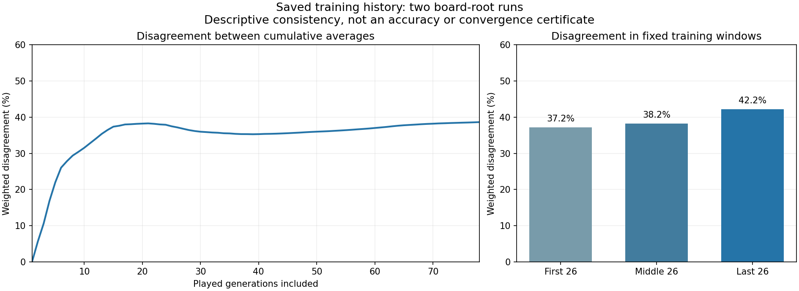

# Saved training history: disagreement persists late

The new estimator reduced disagreement relative to the previous method, but
the two candidate runs did not settle toward the same ranges during the saved
training window. This is not enough evidence to assume that simply running
more iterations will solve the problem.

All 79 saved root states from both runs were inspected. The evaluated averages
were reproduced using played generations 0-77 with weights 1-78; unplayed
generation 78 was excluded and used only for the endpoint movement diagnostic.
Every class and transition is retained in `board-root-trajectory-v1-result.json`.

## What changed during training

| Run | Middle-to-last window change | Mean change per late update |
| --- | ---: | ---: |
| First control | 15.04% | 2.11% |
| First board-root candidate | 15.26% | 1.82% |
| Second control | 13.87% | 2.03% |
| Second board-root candidate | 13.30% | 1.88% |

These are entry-weighted total variation measures. Lower per-update movement
does not mean that the learned strategy is correct. Both new runs still changed
substantially between the middle and last fixed 26-generation windows.

Disagreement **between the candidate runs** was 37.17% in the first window,
38.20% in the middle window, and 42.20% in the last window. Their cumulative
played-average disagreement was 36.12% after 52 generations and 38.63% after
all 78. This descriptive pattern does not demonstrate convergence, nor establish
that longer training would necessarily make things worse. There are only two runs.

For example, in the last window one candidate called 88 every time while the
other raised it every time. For TT, one candidate jammed about 77% while the other
raised every time. These are post-result examples from the complete table,
not independently selected tests or proof of the correct poker action.

## What this does and does not tell us

The remaining discrepancy is not confined to an early noisy period that the
averages have already overcome. The histories alone cannot tell us whether it
comes from noisy values, different learned continuations, nearly tied actions,
or their interaction. Averaging the two runs together would hide disagreement
without establishing a reliable solution.

The next useful question is: under the same fixed continuation policies, how
much is actually lost by calling, raising, folding, or shoving with each hand?
That separates visually different ranges from materially different decisions.

The retained evaluation contains the full action probabilities and physical
deals, although its native output contains only the mixed root values. We can
re-evaluate forced root actions using those saved probabilities. This can reuse
the completed evaluation instead of repeating model inference or training.
The proposed bounded control and scope are in
[BOARD-ROOT-ACTION-DECOMPOSITION-PLAN.md](BOARD-ROOT-ACTION-DECOMPOSITION-PLAN.md).

## Verification and cost

Two CPU workers completed the original diagnostic in 11.67 seconds; no GPU,
new sampled deals, or fits were needed. Independent readback checked all 158
original model files, all 169 classes per run, all 78 transitions, and the window
and prefix reductions using 40-digit arithmetic. Maximum numerical discrepancy
was 4.44e-16. The initial-generation fallback was separately checked against
the actual CPU inference in the diagnostic.

This is verification of saved roots and descriptive arithmetic, not a new poker
engine, payoff evaluation, best-response certificate, or accuracy guarantee.
No production model or completed experiment was changed.
