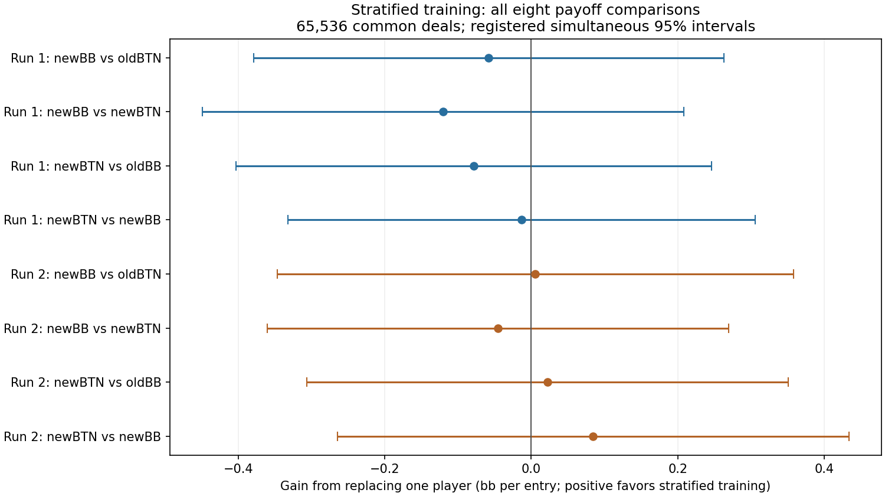

# Stratified training: completed comparison

All eight registered payoff comparisons are reported below. Their simultaneous
intervals support a positive gain in 0, a negative gain in 0,
and leave 8 inconclusive. These counts are per tested player and
fixed opponent, not a general ranking or an equilibrium certificate.

## What was compared

Two stratified training runs were compared with the two previously completed
baselines in the restricted 200bb BB-versus-BTN game (2bb open, 0.5bb dead money,
5% rake capped at 2bb). The runs share seed identities and settings, but different
sampling algorithms do not produce identical training deals. Baselines were
already known before this candidate study.

Each candidate uses 78 updates of 512 deals, guarantees at least three observations
per starting-hand class per update, and carries source-deal importance weights
through learning. This does not eliminate variation among runouts within a class.
Evaluated strategies average all played generations 0-77 with weights 1-78 and
own-action reach. Unplayed generation 78 was not selected for evaluation.

## Range consistency

Entry-weighted cross-seed total variation is **46.94% for the baseline**
and **49.65% for stratified training**.
The candidate-minus-baseline difference is
**+2.71 percentage points**;
negative means less disagreement between these two runs. This is descriptive.
It is not the percentage of hands played incorrectly and does not measure EV loss.
The most frequent action differs across seeds in
95 baseline classes and
96 stratified classes, out of 169.

| Complete bank | Fold | Call | Raise | Jam |
| --- | ---: | ---: | ---: | ---: |
| first-old | 45.46% | 38.59% | 15.81% | 0.14% |
| first-new | 43.14% | 40.62% | 15.94% | 0.30% |
| replication-old | 43.59% | 37.96% | 17.64% | 0.80% |
| replication-new | 37.28% | 40.42% | 21.67% | 0.64% |

Aggregate frequencies can hide per-hand disagreement. The
[complete class table](weighted-final-all-hand-classes.json) contains all 169
native class labels, entry masses, all four policies and per-class distances.

## Coverage and policy movement

| Arm | Classes absent per update | Middle-to-last window TV | Mean step TV, last 26 updates |
| --- | ---: | ---: | ---: |
| 9266201-baseline | 18.88 | 12.14% | 1.84% |
| 9266201-stratified | 0.00 | 15.04% | 2.11% |
| 9266301-baseline | 19.04 | 16.37% | 2.36% |
| 9266301-stratified | 0.00 | 13.87% | 2.03% |

Windows contain played generations 0-25, 26-51 and 52-77 with their original
generation-plus-one weights normalized within each window. Every consecutive
update and every class appears in the [full trajectory](weighted-root-trajectory-v1-result.json).
Its last-current-versus-average diagnostic includes unplayed generation 78 only
as a diagnostic. Reduced movement alone does not establish better poker play.

## Payoff comparisons

Positive means the replacement player gained against the named fixed opponent.
Units are bb per entry into this research spot, not bb/100 dealt hands.
The fixed test used 65,536 fresh common physical deals, seed 9278101, eight crossed
profiles, and one final statistical look. Intervals use the registered bounded
empirical-Bernstein method with Bonferroni adjustment across eight contrasts.

| Replacement and fixed opponent | Mean gain | Paired standard error | Simultaneous 95% interval |
| --- | ---: | ---: | ---: |
| first:newBB-v-oldBB-against-oldBTN | -0.0580 | 0.0381 | [-0.3791, +0.2630] |
| first:newBB-v-oldBB-against-newBTN | -0.1205 | 0.0402 | [-0.4493, +0.2084] |
| first:newBTN-v-oldBTN-against-oldBB | -0.0784 | 0.0390 | [-0.4029, +0.2461] |
| first:newBTN-v-oldBTN-against-newBB | -0.0136 | 0.0375 | [-0.3327, +0.3054] |
| replication:newBB-v-oldBB-against-oldBTN | +0.0056 | 0.0468 | [-0.3469, +0.3582] |
| replication:newBB-v-oldBB-against-newBTN | -0.0454 | 0.0364 | [-0.3606, +0.2699] |
| replication:newBTN-v-oldBTN-against-oldBB | +0.0220 | 0.0402 | [-0.3068, +0.3508] |
| replication:newBTN-v-oldBTN-against-newBB | +0.0844 | 0.0459 | [-0.2649, +0.4338] |

An interval containing zero is inconclusive, not proof of equivalence. Large-pot
outcomes and the fixed payoff bounds limit precision. No favorable seed or
checkpoint was selected, no sample extension followed the outcomes, and no
narrower post-hoc interval replaces the registered result.

## Verification and remaining scope

Both candidate training histories passed full independent readback. The final
evaluation review checked 2,048 batches and 29,772,319
policy observations, the registered chance stream, crossed profiles, cashflows,
root summaries and all eight statistical reductions. Maximum statistical
discrepancy was 1.42e-12.
This review does not independently reimplement the poker engine and is not a
best-response or exploitability certificate.

These findings require scientific interpretation before a next experiment is
chosen. No automatic promotion or deployment follows this report. Other positions,
stacks, sizing menus, multiway pots and agreement with GTO Wizard remain unproven.
Production was not changed by this research report.
